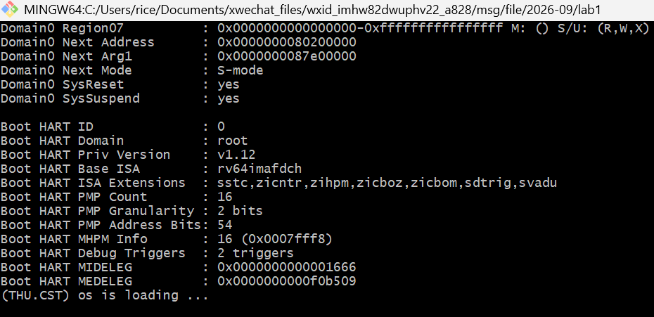
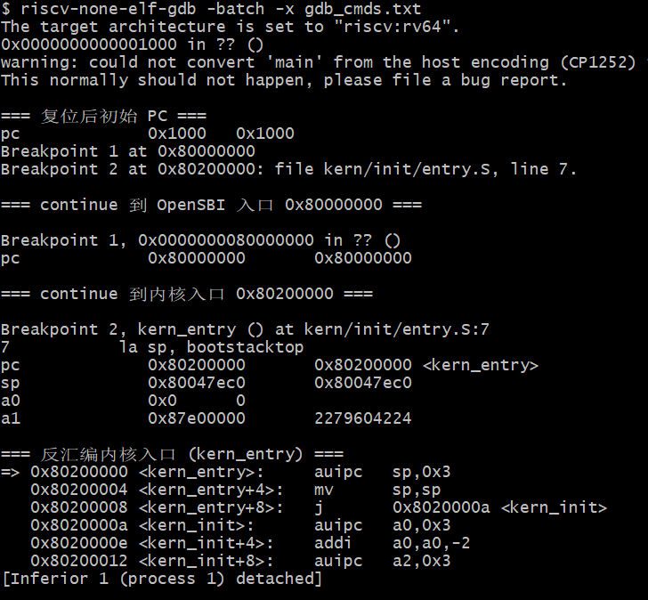

# 操作系统实验报告

## 实验基本信息

| 项目 | 内容 |
|------|------|
| **实验名称** | Lab 1: 最小可执行内核 |
| **小组成员** | 【2411938-唐源】、【2413905-马诗渊】、【2413140-颜国庄】 |
| **完成日期** | 2026-10-8 |

### 小组分工


| 成员 | 负责的练习/模块 |
|------|----------------|
| 【2411938-唐源】 | 【练习1：内核启动入口分析 / 环境配置】 |
| 【2413905-马诗渊】 | 【练习2：GDB 验证启动流程】 |
| 【2413140-颜国庄】 | 【编译构建与 QEMU 运行调试】 |

实验报告如何分工？

【2411938-唐源】负责「实验目的 / 实验环境 / 整体逻辑分析 / 内核入口模块 / 练习1」；【2413905-马诗渊】负责「输出链路模块 / 练习2 / 总结（知识点与 OS 原理对照）」；【2413140-颜国庄】负责「链接脚本与构建模块 / 测试与验证 / AI 协作经验」。


---

## 一、实验目的

本实验的主要目的是：

1. 构建一个最小可执行内核（"比麻雀更小的麻雀"）：在 QEMU 模拟的 64 位 RISC-V 机器上启动，通过 SBI 接口格式化打印一行 `(THU.CST) os is loading ...`，然后进入死循环。
2. 理解并验证操作系统的完整启动流程：加电复位 → MROM 复位代码 → OpenSBI 固件 → 内核入口，掌握"固件 → 引导程序 → 操作系统"三级接力的思想。
3. 掌握从汇编入口（`entry.S`）到 C 语言入口（`kern_init`）的控制权移交过程，理解内核栈的建立与 `.bss` 段清零。
4. 自底向上理解裸机环境下的输入输出：从 `ecall`/SBI 调用开始，逐层封装出 `cprintf` 格式化打印。
5. 学习使用 AI 辅助开发操作系统代码：借助 AI 完成工具链配置、Makefile 适配、启动问题排查与 GDB 调试。

---

## 二、实验环境

你们使用的 AI 工具

| 成员 | AI 编程工具 | 底层模型 | 备注 |
|------|------------|---------|------|
| 【2411938-唐源】 | Claude Code（终端 Agent） | deepseek-v4-pro |  |
| 【2413905-马诗渊】 | Claude Code | DeepSeek |  |
| 【2413140-颜国庄】 | Codex | GPT |  |

**说明：**
- **AI 编程工具**：指具体使用的终端工具、编辑器插件、桌面应用或浏览器界面
- **底层模型**：指该工具使用的大语言模型及版本


**软件环境（本机原生 Windows）：**
- 操作系统：Windows 11（Git Bash 作为 shell）
- 交叉编译工具链：xpack `riscv-none-elf-gcc` 15.2.0（含 gdb 16.3、ld/objcopy/objdump）
- 模拟器：xpack QEMU `qemu-system-riscv64` 9.2.4（内置 OpenSBI 1.5.1，`fw_dynamic`）
- 构建工具：GNU Make 4.4.1（ezwinports）

---

## 三、实验整体逻辑分析

### 2.1 本章节的逻辑主线

lab1 是整个实验的预备：构建一个"最小可执行内核"骨架。它只做一件事——在 QEMU 模拟的 64 位 RISC-V 机器上启动，打印一行 `(THU.CST) os is loading ...`，然后进入死循环。

本章围绕"让内核第一次跑起来"这一核心主题展开，解决的核心问题是：一段 C 代码如何在没有标准库、没有操作系统的裸金属上启动并输出信息。它按照"内核从哪来 → 怎么跑起来 → 怎么和外界说话 → 怎么构建 → 怎么验证"这条逻辑线展开，为后续 lab2~lab6 的进程、内存、文件系统等功能打下地基。

### 2.2 功能的逐步实现

本章按照如下顺序逐步实现各功能，顺序由"依赖关系"决定——每一层都建立在上一层之上：

1. **首先固定内存布局与入口点**（`tools/kernel.ld`、`kern/init/entry.S`）→ 因为内核代码是**地址相关**的，必须先确定内核放在内存的哪个物理地址（`0x80200000`）、从哪个符号（`kern_entry`）开始执行，后续的加载与跳转才有依据。
2. **接着打通启动流程**（复位代码 → OpenSBI → 内核）→ 因为只有先弄清楚"内核是怎么被加载并运行的"，才能验证入口点是否真的被执行到。
3. **然后实现自底向上的输出链路**（`ecall`/`sbi_call` → `sbi_console_putchar` → `cons_putc` → `cputs` → `vprintfmt` → `cprintf`）→ 因为"能在屏幕上打印"是内核与外界沟通、也是后续所有调试和验证的前提；同时它演示了 RISC-V 下系统调用的底层机制 `ecall`。
4. **再完成编译构建**（`Makefile`、`tools/function.mk`）→ 交叉编译出 ELF，再用 `objcopy` 转成裸二进制 `ucore.img` 供 OpenSBI 加载，把前面所有源码串联成一个可运行镜像。
5. **最后用 GDB 验证**（远程调试）→ 通过单步、断点、看寄存器，确认启动流程和入口操作符合预期，形成"实现 → 验证"的闭环。

---

## 四、实验内容与实现

### 功能模块：内核入口与初始化

**负责人：** 【2411938-唐源】

#### 模块功能描述

**需要实现/修改的函数：**

```c
// kern/init/entry.S —— 汇编入口
void kern_entry(void);      // 设置内核栈并跳入 C 入口

// kern/init/init.c —— C 语言内核入口
int kern_init(void) __attribute__((noreturn));   // 清 .bss、打印、死循环
```

**功能说明：**

- `kern_entry` 是内核最先执行的地方（链接脚本 `ENTRY(kern_entry)` 指定），它设置内核栈指针 `sp` 并尾调用 `kern_init`，完成"汇编 → C"的控制权移交。
- `kern_init` 使用链接脚本 `PROVIDE` 的 `edata`/`end` 符号清空 `.bss` 段，再调用 `cprintf` 打印启动信息，最后死循环。
- 该模块是整个内核的起点：栈就绪、全局变量清零、进入 C 代码，是后续所有 C 功能运行的前提。

### 功能模块：输出链路（SBI 调用与格式化打印）

**负责人：** 【2413905-马诗渊】

#### 模块功能描述

**需要实现/修改的函数：**

```c
// libs/sbi.c —— SBI 调用封装
uint64_t sbi_call(uint64_t sbi_type, uint64_t arg0, uint64_t arg1, uint64_t arg2);
void sbi_console_putchar(int c);

// kern/driver/console.c —— 控制台封装
void cons_putc(int c);

// kern/libs/stdio.c + libs/printfmt.c —— 格式化输出
int cprintf(const char *fmt, ...);
void vprintfmt(void (*putch)(int, void*), void *putdat, const char *fmt, va_list ap);
```

**功能说明：**

- 从最底层 `ecall`（SBI 接口）出发，层层封装：`sbi_call` → `sbi_console_putchar` → `cons_putc` → `cputch`/`cputs` → `vprintfmt` → `cprintf`。
- `sbi_call` 把"跨特权级调用固件服务"封装成普通 C 函数：功能号放 `a7`、参数放 `a0~a2`，`ecall` 从 S 模式陷入 M 模式由 OpenSBI 处理，返回值取 `a0`。
- `vprintfmt` 是格式化核心，支持 `%d/%u/%x/%p/%s/%c/%%`，`printnum` 递归按任意进制打印数字。

### 功能模块：链接脚本与构建系统

**负责人：** 【2413140-颜国庄】

#### 模块功能描述

**需要实现/修改的文件：**

```makefile
# tools/kernel.ld —— 链接脚本
BASE_ADDRESS = 0x80200000;
ENTRY(kern_entry)

# Makefile —— 交叉编译 + QEMU 运行
make qemu     # 编译 → 链接 → objcopy 生成 bin/ucore.img → QEMU 加载
make debug    # 带 -s -S 挂起，等待 GDB
```

**功能说明：**

- `kernel.ld` 规定内核段布局：`BASE_ADDRESS = 0x80200000`，依次放置 `.text → .rodata → .data/.sdata → .bss`，`PROVIDE` 出 `etext`/`edata`/`end` 边界符号，`/DISCARD/` 丢弃 `.eh_frame` 等无用段。
- `Makefile` 定义交叉编译工具链（本机 xpack 的 `riscv-none-elf-`），用 `objcopy --strip-all -O binary` 生成裸镜像 `ucore.img`。
- 内核固定到 `0x80200000` 是因为内核是**地址相关**代码，必须加载到 OpenSBI 约定的移交位置。

#### 最终提示词

以下是经过迭代优化后，最终成功实现该功能的提示词：

````markdown
【RELY】
这是一个 RISC-V 64 位教学操作系统（uCore）的 lab1，要求构建最小可执行内核。
现有源码结构：kern/init/entry.S（汇编入口）、kern/init/init.c、kern/driver/console.c、
kern/libs/stdio.c、libs/printfmt.c、libs/sbi.c、tools/kernel.ld、tools/function.mk、Makefile。

【SPECIFICATION】
1. 本机使用 xpack 工具链，前缀是 riscv-none-elf-（不是课程文档的 riscv64-unknown-elf-）。
2. xpack 默认目标架构是 rv32，需在 CFLAGS 显式加 -march=rv64imac -mabi=lp64。
3. gdb 的目标需硬编码为 riscv-none-elf-gdb。
4. 本机 QEMU 9.2.4 内置 OpenSBI 是 fw_dynamic，请用 -kernel bin/ucore.img 加载内核，
   而不是 -device loader,file=ucore.img,addr=0x80200000（后者不设跳转地址，内核不会启动）。
5. 在 Git Bash 中执行 make（ezwinports make 依赖 sh.exe 执行 recipe）。

【TASK】
修改 Makefile 三处（工具链前缀、-march/-mabi、gdb 目标），并把 QEMU 启动参数改为 -kernel，
使 make qemu 能成功输出 "(THU.CST) os is loading ..."。
````

#### 实现迭代过程

本模块的实现经历了 6 次迭代，过程如下：

---

##### 第一次迭代

**遇到的问题：**
- 问题1：GitHub 直连下载 xpack 工具链被墙，SSL 报错，无法获取二进制。
- 问题2：xpack 的 npm 包是空壳，安装后没有真正的可执行文件。

**问题解决策略：**
- 针对问题1：改用 `gh-proxy.com` 前缀代理 GitHub releases 下载。
- 针对问题2：不从 npm 安装，改为直接从 GitHub releases 下载二进制压缩包解压到 `E:\riscv-tools\`。

---

##### 第二次迭代

**遇到的问题：**
- 问题1：编译报错找不到 `riscv64-unknown-elf-gcc`——课程文档写的工具链前缀与本机实际不符。

**问题解决策略：**
- 针对问题1：将 Makefile 的 `GCCPREFIX` 改为本机实际的 `riscv-none-elf-`。

---

##### 第三次迭代

**遇到的问题：**
- 问题1：编译报错"目标架构不匹配"，xpack 默认编译 32 位 RISC-V，而内核是 64 位。

**问题解决策略：**
- 针对问题1：在 CFLAGS 中显式加入 `-march=rv64imac -mabi=lp64`，强制 64 位目标。

---

##### 第四次迭代

**遇到的问题：**
- 问题1：gdb 调试脚本仍调用默认的 `gdb`，而非交叉工具链自带的 gdb。
- 问题2：在纯 cmd/PowerShell 里执行 `make` 失败，因为没有 `sh.exe`。

**问题解决策略：**
- 针对问题1：把 gdb 目标硬编码为 `riscv-none-elf-gdb`。
- 针对问题2：改在 Git Bash 中执行 `make`（ezwinports make 依赖 sh 执行 recipe）。

---

##### 第五次迭代

**遇到的问题：**
- 问题1：`make qemu` 只打印 `Domain0 Next Address = 0x0`，内核没有启动，不输出 `(THU.CST) os is loading ...`。

**问题解决策略：**
- 针对问题1：定位为 QEMU 9.2.4 内置 OpenSBI 是 `fw_dynamic`，原 Makefile 的 `-device loader,file=...,addr=0x80200000` 只把镜像放进内存、不设置跳转地址。改用 `-kernel bin/ucore.img`，让 OpenSBI 正确跳到 `0x80200000`。

---

##### 第六次迭代

**最终结果：**

经过 6 次迭代，该模块最终：
- ✅ 编译通过（`make clean && make` 干净编译成功）
- ✅ `make qemu` 成功输出 `(THU.CST) os is loading ...`
- ✅ `make debug` + gdb 远程调试正常，断点全部命中

**关键改进点总结：**
1. 在 Makefile 中统一了工具链前缀为 `riscv-none-elf-`。
2. 在 CFLAGS 中补充了 `-march=rv64imac -mabi=lp64`，消除 32 位默认目标导致的架构不匹配。
3. 把 gdb 目标硬编码为 `riscv-none-elf-gdb`，避免调用系统默认 gdb。
4. 用 QEMU `-kernel` 替代 `-device loader`，适配新版 `fw_dynamic` OpenSBI 的启动方式。

---

### 练习1：理解内核启动中的程序入口操作

**负责人：** 【2411938-唐源】

**`la sp, bootstacktop` 完成了什么操作，目的是什么？**

`la`（load address）是伪指令，把符号 `bootstacktop` 的地址装入栈指针寄存器 `sp`（会被汇编器展开为 `auipc` + `addi`，因为 RISC-V 单条指令的立即数装不下完整地址）。`bootstacktop` 是内核栈的栈顶（最高地址），RISC-V 的栈满递减（从高地址向低地址增长）。这条指令把 `sp` 指向空栈的栈顶，为 C 语言代码（`kern_init` 及其后续函数调用、局部变量、保存寄存器）准备好栈空间。

**`tail kern_init` 完成了什么操作，目的是什么？**

`tail` 是尾调用伪指令（展开为 `auipc t0, ...` + `jr t0, ...`），特点是**不把返回地址写入 `ra`**、不建立新的调用栈帧。它把控制权交给 C 语言编写的内核初始化函数 `kern_init()`。因为 `kern_init` 是 `noreturn` 的（结尾是 `while(1);` 死循环），永远不需要返回，用尾调用最合适，省去了保存返回地址的开销。此后汇编代码的使命结束，CPU 执行流程进入 C 代码。

---

### 练习2：使用 GDB 验证启动流程

**负责人：** 【2413905-马诗渊】

**RISC-V 硬件加电后最初执行的几条指令位于什么地址？主要完成哪些功能？**

最初执行的指令位于**复位地址 `0x1000`**。CPU 上电时 PC 被硬线复位到 `0x1000`，这里放的是 QEMU 内置的机器复位代码（MROM），没有符号信息，GDB 中显示为 `0x0000000000001000 in ?? ()`。它完成最基本的环境准备（初始化各硬件组件到初始状态），然后跳转到 `0x80000000`——OpenSBI 固件的加载位置。

OpenSBI 随后在 M 模式进行主初始化：初始化处理器运行环境（设置 `mstatus`、`medeleg`/`mideleg` 异常委托、PMP、串口等），核心任务之一是把内核镜像加载到 `0x80200000`，最后跳转过去，把 CPU 控制权移交给内核。

**调试过程与观察结果（本机实测记录）：**

1. 终端 A 执行 `make debug`：QEMU 带 `-s -S` 启动，CPU 一上电即暂停在复位地址，监听 1234 端口等待 GDB。
2. 终端 B 执行 `make gdb`：GDB 加载 `bin/kernel`、设架构 `riscv:rv64`、连接 `localhost:1234`。连接后 `info registers pc` 显示 `pc = 0x1000`（`0x0000000000001000 in ?? ()`），此刻还在固件阶段，尚未进入内核。
3. 反汇编复位地址 `0x1000` 处代码（`x/8i $pc`）：

   ```
   => 0x1000:	auipc	t0,0x0
      0x1004:	addi	a2,t0,40
      0x1008:	csrr	a0,mhartid
      0x100c:	ld	a1,32(t0)
      0x1010:	ld	t0,24(t0)
      0x1014:	jr	t0
   ```
   这是 QEMU 内置的机器复位代码（MROM）：`csrr a0, mhartid` 读取硬件线程号，再从一段固定偏移的地址表取固件入口（`ld t0, 24(t0)`，即 `0x80000000`），最后 `jr t0` 跳转到 OpenSBI 固件。

4. 分别在 OpenSBI 入口与内核入口下断点 `b *0x80000000`、`b *0x80200000`，两次 `continue` 依次命中：
   - `pc = 0x80000000`——OpenSBI 固件入口，验证中间一级接力；
   - `pc = 0x80200000`——内核入口 `kern_entry`。此时 `sp = 0x80047ec0`（仍是 OpenSBI 的残留栈值，`la sp, bootstacktop` 尚未执行）、`a0 = 0x0`（硬件线程号 hartid）、`a1 = 0x87e00000`（OpenSBI 移交的设备树 DTB 指针）。
5. 反汇编内核入口（`x/6i $pc`）并单步验证：

   ```
   => 0x80200000:	auipc	sp,0x3        # la sp, bootstacktop 高 20 位
      0x80200004:	mv	sp,sp          # addi sp,sp,0（低 12 位恰为 0）
      0x80200008:	j	0x8020000a     # tail kern_init（松弛为 2 字节压缩指令 c.j）
   ```
   `si` 单步执行完 `auipc sp,0x3` 后，`sp` 由残留值 `0x80047ec0` 变为 `0x80203000`，恰好等于符号 `bootstacktop` 的地址（内核栈顶；栈区 `bootstack` 为 `0x80201000~0x80203000`，共 8KB）。`tail kern_init` 因目标近在咫尺，被链接器松弛成一条 2 字节压缩跳转 `c.j`（工具链 `-march=rv64imac` 启用了 RVC 压缩指令扩展），直接跳入 `kern_init`（地址 `0x8020000a`）。

**结论**：GDB 实测完整复现了「复位代码（`0x1000`）→ OpenSBI（`0x80000000`）→ 内核（`0x80200000`）」的三级接力，与「固件 → 引导程序 → 操作系统」的现代计算机启动思想一致。`sp` 在 `la` 前后从 OpenSBI 残留值变为 `bootstacktop`，验证了 `entry.S` 中设置内核栈的作用；`a0`/`a1` 的取值也印证了 OpenSBI 按 SBI 规范移交硬件线程号与设备树指针。

---

## 五、测试与验证

**测试截图：**





**测试结果说明：**

1. `make clean && make` 干净编译通过，无警告无错误。
2. `make qemu` 运行结果：OpenSBI 打印 `Domain0 Next Address = 0x80200000`、`Next Mode = S-mode`，随后内核输出 `(THU.CST) os is loading ...`。
3. `make debug` + gdb 脚本（`-batch -x`）三个断点全部命中，寄存器观察结果与上文练习2 一致。

---

## 六、实验总结与收获

### 对操作系统的理解

1. **本实验重要知识点与 OS 原理的对应关系：**

| 本实验知识点 | 对应 OS 原理知识点 | 关系与差异 |
|---|---|---|
| RISC-V 特权级 U/S/M，内核在 S、固件在 M | 用户态/内核态（内核态/用户态） | 同一思想的 RISC-V 化：用特权级隔离内核与用户，M 模式还承担了"比内核更底层"的固件角色 |
| `ecall` 从 S 模式陷入 M 模式调 SBI | 系统调用（syscall） | `ecall` 就是系统调用的底层机制；SBI 调用是"内核 → 固件"的系统调用，而一般 syscall 是"用户 → 内核" |
| bootloader（OpenSBI）加载内核 | 引导程序 / 系统启动 | OpenSBI 相当于 BIOS/UEFI + 引导程序，完成"把 OS 加载进内存并移交控制权" |
| 链接脚本、`.text/.rodata/.data/.bss/stack/heap` 段布局 | 进程地址空间、可执行文件格式（ELF） | 段的概念一致；本实验只关心内核镜像的静态布局，尚未涉及进程的虚拟地址空间 |
| `.bss` 段清零（`memset(edata,0,end-edata)`） | 未初始化数据区 | 与普通程序由加载器/`crt0` 完成的工作对应，这里由内核自己完成 |
| 交叉编译、objcopy 生成 bin 镜像 | 编译-链接-加载全流程 | ELF 含调试信息与段描述，bin 是线性裸镜像；OpenSBI 只认简单的 bin |
| 地址相关代码（固定 `0x80200000`） | 链接与重定位（地址无关代码 PIC） | 内核被固定加载，故是地址相关；PIC 是"加载时确定位置"的更高要求 |

2. **OS 原理中重要、但本实验没有对应的知识点：**

   1. **进程管理与调度** —— 本实验内核是单控制流的死循环，尚无 PCB、上下文切换、调度算法（对应 lab4/lab6）。
   2. **虚拟内存 / 页表 / 地址翻译** —— 只静态分配了内核栈，没有分页、缺页、TLB 管理（对应 lab2）。
   3. **中断与异常处理机制** —— `kern/trap`、`trapentry.S` 尚未出现，没有完整的 trap 向量表和中断服务例程（对应 lab3）。
   4. **并发与同步互斥** —— 没有锁、信号量、临界区等。
   5. **文件系统与 I/O 设备管理** —— 输出只是 SBI 的字符接口，没有磁盘、文件、块设备驱动。
   6. **用户态程序与系统调用接口** —— 尚无用户进程与完整的 syscall 分发（对应 lab5）。

### AI 协作开发的经验

1. **AI 擅长"环境适配"，但需要人提供准确的本机事实。** 本次最大的坑（工具链前缀、默认 rv32、`fw_dynamic` OpenSBI）都是本机特有的，AI 无法凭空知道；一旦在提示词里如实描述"本机是 xpack 工具链 / 新版 QEMU"，AI 就能快速定位并给出针对性修改。**结论：喂给 AI 的上下文越具体，产出越准。**
2. **提示词要"带约束迭代"，而不是一次写全。** 一开始让 AI"配好工具链"得到的往往是用课程文档默认值（`riscv64-unknown-elf-`）；改为在提示词里显式声明"本机前缀是 `riscv-none-elf-`、目标是 64 位、用 `-kernel`"之后，AI 一次到位。**结论：把"已知的约束"写进 [SPECIFICATION]，比事后让 AI 猜更高效。**
3. **报错信息是最好的提示词。** 每次编译/运行报错（架构不匹配、Next Address=0x0、找不到 sh）直接贴给 AI，AI 能迅速定位根因并给出修复。**结论：不要只描述"不行了"，要把原始错误输出一起给 AI。**
4. **AI 的调试建议需要人验证。** GDB 实测数据（`sp` 从 `0x80047ec0` 变为 `0x80203000`、`tail` 松弛成 `c.j`）是 AI 给出调试步骤后、由人实际执行记录下来的，这既验证了 AI 的判断，也产出了报告需要的真实证据。**结论：AI 负责"给出路径"，人负责"确认事实"。**
