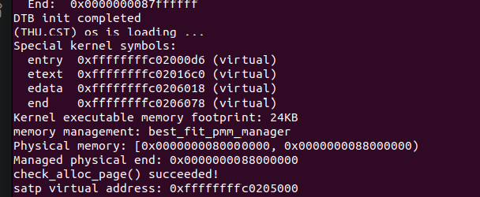
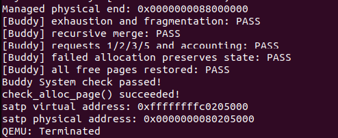
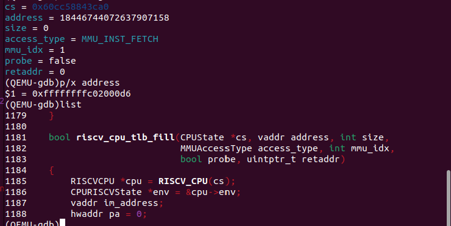
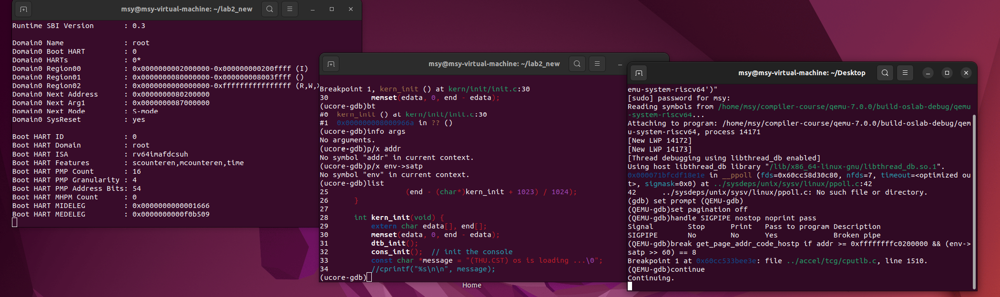

# 操作系统实验报告

## 实验基本信息

| 项目 | 内容 |
| --- | --- |
| **实验名称** | Lab 2：物理内存和页表 |
| **小组成员** | 【2411938-唐源】、【2413905-马诗渊】、【2413140-颜国庄】 |
| **报告日期** | 2026-10-22 |

### 小组分工

| 成员 | 负责的练习/模块 |
| --- | --- |
| 【2411938-唐源】 | 构建与启动配置、启动页表分析、QEMU 双重 GDB 调试与结果分析 |
| 【2413905-马诗渊】 | Best-Fit、Buddy System、算法测试设计、分配与回收结果分析 |
| 【2413140-颜国庄】 | 物理内存探测与 `page_init()`、页描述符布局、First-Fit 分析与改进思考 |

**报告分工：** 唐源负责实验环境、启动页表与 QEMU 调试；马诗渊负责 Best-Fit、Buddy 和算法测试；颜国庄负责实验目的、整体逻辑、物理内存初始化与 First-Fit 分析。实验总结由三名成员共同完成。

---

## 一、实验目的

1. 理解页表的建立和使用方法，区分虚拟地址、物理地址、物理页号和页描述符地址。
2. 掌握从设备树读取物理内存范围、确定管理边界、建立 `Page` 描述符数组与注册空闲页的方法。
3. 阅读 First-Fit，实现 Best-Fit，理解连续物理页分配中的查找、拆分、回收和相邻空闲块合并。
4. 实现 Buddy System 并单独设计测试，理解按阶管理、二分拆分、伙伴合并、内部碎片与空闲页计数。
5. 使用两个 GDB 分别调试 QEMU 和 RISC-V 内核，分析软件 TLB 与 Sv39 地址翻译的调用链。
6. 学习用明确的 spec、提示词和真实测试反馈约束 AI 生成结果，检查接口、边界、状态约定及调试结论。

---

## 二、实验环境

**AI 编程工具：**

| 成员 | AI 编程工具 | 底层模型 | 备注 |
|------|------------|---------|------|
| 【2411938-唐源】 | Claude Code（终端 Agent） | deepseek-v4-pro |  |
| 【2413905-马诗渊】 | Claude Code | DeepSeek |  |
| 【2413140-颜国庄】 | Codex | GPT |  |

**软件环境：**

- 宿主机与虚拟化软件：Windows、VMware。
- 实验系统：Ubuntu，工程目录为 `/home/msy/lab2_new`。
- 交叉编译工具链：`riscv64-unknown-elf-gcc`、`ld`、`objcopy`、`objdump`。
- 构建工具：GNU Make。
- 系统模拟器：`/usr/bin/qemu-system-riscv64`，版本为 6.2.0。
- 调试模拟器：在 `qemu-7.0.0` 源码目录中独立构建，使用 `--enable-debug --enable-debug-info` 保留调试信息。
- 调试器：原生 `gdb` 调试 QEMU，`gdb-multiarch` 调试 RISC-V 内核。
- 内核 GDB 接口：`localhost:1234`。

**构建与运行：**

Makefile 通过 `-kernel bin/ucore.img` 加载原始内核镜像，GDB 加载 `bin/kernel` 中的 ELF 符号。`make debug` 增加 `-s -S`，使 QEMU 开启 GDB 服务并暂停虚拟 CPU。

~~~bash
cd /home/msy/lab2_new
make
make qemu
~~~

源码调试时使用独立二进制：

~~~bash
make debug QEMU=/home/msy/compiler-course/qemu-7.0.0/build-oslab-debug/qemu-system-riscv64
~~~

---

## 三、实验整体逻辑分析

### 3.1 本章节的逻辑主线

本章围绕“让内核能够管理和使用物理内存”展开。内核启动后，首先需要知道内存从哪里开始、有多大，再确定哪些部分已经被占用，随后建立页面状态记录，并按照具体算法完成连续物理页的分配与回收。

实验按照“发现内存 → 建立描述符 → 注册空闲页 → 实现分配算法 → 验证地址映射”的顺序展开。物理页分配器管理可用资源，页表记录虚拟地址与物理地址的对应关系，两者共同构成内存管理的基础。

### 3.2 功能的逐步实现

1. **选择管理器。** `init_pmm_manager()` 指定 Best-Fit 或 Buddy，通过统一接口初始化算法内部结构。
2. **探测并初始化物理内存。** `page_init()` 从设备树获得 RAM 范围，设置地址偏移与页号上界，建立描述符并保留已占用部分。
3. **注册空闲区。** `init_memmap()` 将真正可用的连续页面交给当前算法。
4. **进行分配和回收。** `alloc_pages()/free_pages()` 转发到管理器的实现，维护空闲结构和页数。
5. **运行算法检查。** 页面初始化、Best-Fit 和 Buddy 分别用对应测试验证。
6. **观察地址翻译。** 使用双重 GDB 对照内核虚拟地址、QEMU 调用栈与 Sv39 翻译过程。

~~~text
pmm_init()
  ├─ init_pmm_manager()
  │    └─ pmm_manager->init()
  ├─ page_init()
  │    ├─ 获取并检查设备树内存范围
  │    ├─ 建立 Page 描述符数组
  │    └─ init_memmap()
  │         └─ pmm_manager->init_memmap()
  └─ check_alloc_page()
       └─ pmm_manager->check()

后续申请/回收：
alloc_pages(n)     -> pmm_manager->alloc_pages(n)
free_pages(p, n)   -> pmm_manager->free_pages(p, n)
~~~

---

## 四、实验内容与实现

### 功能模块：物理内存探测与页描述符初始化

**负责人：** 【2413140-颜国庄】

#### 模块功能描述

需要实现的函数位于 `kern/mm/pmm.c`：

~~~c
static void page_init(void);
~~~

该函数不接收参数、不返回结果，通过全局变量和管理器接口建立内存管理的初始状态。完成后应正确设置 `va_pa_offset`、`npage`、`pages`，并仅将完整、可用的页面交给分配器。

#### 功能要求与 Spec 设计

| 项目 | 本次约定 |
| --- | --- |
| 前置条件 | DTB 初始化已完成，能够获取 RAM 起点与大小；当前管理器已执行 init |
| 地址处理 | 明确区分内核虚拟地址、物理地址、页号和描述符地址 |
| 管理边界 | 支持本框架从 DRAM_BASE 开始的单段 RAM，管理上界不超过 PHYSICAL_MEMORY_END |
| 描述符布局 | 将 Page 数组放在内核结束位置之后，按页对齐，并检查整个数组能够放入管理范围 |
| 保留区域 | OpenSBI、内核镜像、描述符数组以及必要的对齐空间不能进入空闲区 |
| 异常处理 | 无效内存信息、地址溢出或描述符空间不足时终止初始化 |
| 空区处理 | 没有完整空闲页面时，不调用 init_memmap |
| 后置条件 | 空闲页面能够由当前管理器正确计数、分配和回收 |

#### 核心实现与理解

**1. 初始化固定映射偏移并读取内存信息。**

~~~c
va_pa_offset = PHYSICAL_MEMORY_OFFSET;

uintptr_t mem_base = (uintptr_t)get_memory_base();
uintptr_t mem_size = (uintptr_t)get_memory_size();
uintptr_t mem_end = mem_base + mem_size;
~~~

`mem_end` 是物理 RAM 的结束位置，链接符号 `end` 是内核镜像的虚拟结束位置，两者不能混用。

本次实际输出的 RAM 范围为：

~~~text
Physical memory: [0x0000000080000000, 0x0000000088000000)
Managed physical end: 0x0000000088000000
~~~

该区间大小为 128 MiB。按 4 KiB 分页，一共有 32768 个物理页，但其中包含已占用和保留页，并非全部可供分配。

**2. 检查并限制管理范围。**

代码检查 `mem_base == DRAM_BASE`、非零内存大小，以及地址加法没有回绕；随后将上界限制在 `PHYSICAL_MEMORY_END` 内，并向下按页对齐。起点检查是当前简化框架的适用条件，并非通用操作系统只能支持固定 RAM 起点。

**3. 正确设置页号上界和描述符数组。**

~~~c
npage = PPN(managed_end);
pages = (struct Page *)ROUNDUP((uintptr_t)end, PGSIZE);

uintptr_t pages_pa = PADDR(pages);
size_t page_count = npage - nbase;
~~~

本框架中 `npage` 表示物理页号的上界，`nbase` 是 RAM 起始物理页号，所以描述符数量为 `npage - nbase`。`pages` 指向记录物理页状态的数组，不等同于空闲物理内存起点。

数组占用字节数为 `page_count * sizeof(struct Page)`。实现先检查数组是否放得下，再写入描述符，避免初始化阶段越界。

**4. 预留所有页面，再开放真正的空闲区。**

实现先将所有描述符标为保留、清零引用计数与块信息。描述符数组之后的第一个完整页作为 `free_start`：

~~~c
uintptr_t free_start = ROUNDUP(
    pages_pa + page_count * sizeof(struct Page),
    PGSIZE
);

if (free_start < managed_end) {
    init_memmap(
        pa2page(free_start),
        (managed_end - free_start) / PGSIZE
    );
}
~~~

当前管理器在自己的 `init_memmap()` 中清除这段可用页面的保留状态并登记空闲块。这样保证了初始化范围和分配算法之间的职责明确。

#### 提示词设计

~~~text
【RELY】
这是 RISC-V 64 位 uCore Lab2。请阅读 pmm.c、pmm.h、memlayout.h、
dtb.h 和现有管理器接口，使用框架已有的地址转换与页面状态定义。

【SPECIFICATION】
1. 实现 static void page_init(void)，通过 DTB 接口获取 RAM 范围。
2. 设置 va_pa_offset；检查起点、空大小、地址加法溢出和管理上界。
3. 当前框架 npage 是物理页号上界，描述符数量为 npage - nbase。
4. Page 数组放在内核 end 之后并按页对齐，写入前检查数组空间。
5. 先将所有页面标为保留；排除 OpenSBI、内核与描述符数组。
6. 仅把剩余完整页面通过 init_memmap 注册，空区不调用该接口。
7. 使用现有 panic/cprintf/pa2page/PADDR 等接口，不修改框架测试。

【TASK】
给出可编译的 page_init 实现，并解释各地址的类型、描述符数量、
空闲起点的计算和初始化后应维持的状态。
~~~

#### 实现结果

`check page init` 检查通过。实现正确建立了从 `DRAM_BASE` 开始的页面描述符，并将预留区域之后的完整页面交给当前分配器。

### 思考题：硬件可用物理内存范围如何获取

**问题：如果 OS 无法提前知道当前硬件的可用物理内存范围，有什么方法获取？**

操作系统可以读取固件或引导程序提供的内存布局，而不是通过对任意物理地址进行读写试探来判断。

- **本实验的 RISC-V 平台：** 读取传入设备树中的 memory 节点及 reg 属性，获得 RAM 起点与长度；通用实现还应结合内存保留信息排除不可分配区域。[Devicetree 规范](https://devicetree-specification.readthedocs.io/en/latest/chapter3-devicenodes.html)
- **UEFI 平台：** 引导加载程序可通过 GetMemoryMap 获取带类型的内存描述符，再将布局交给内核，由内核依据类型与启动阶段建立管理结构。[UEFI GetMemoryMap 说明](https://uefi.org/htmlspecs/ACPI_Spec_6_4_html/15_System_Address_Map_Interfaces/uefi-getmemorymap-boot-services-function.html)

本实验通过设备树获取物理内存信息。对于通用平台，内存初始化还需要处理多段 RAM 和各类保留区域。

### 练习1：理解 First-Fit 连续物理内存分配算法

**负责人：** 【2413140-颜国庄】

#### 核心函数分析

阅读 `kern/mm/default_pmm.c`，其主要结构为按地址排列的空闲块链表。每个空闲块通过首个 `Page` 的 `property` 记录连续页数，`nr_free` 统计总空闲页数。

| 函数 | 作用 |
| --- | --- |
| default_init | 初始化空闲链表，将空闲页计数清零 |
| default_init_memmap | 将给定连续页面转为空闲状态，设置块头长度并按地址插入 |
| default_alloc_pages | 从链表头扫描，找到第一个长度不小于 n 的块并分配 |
| default_free_pages | 回收页面、按地址插入空闲块，并尝试与前后物理相邻块合并 |
| default_nr_free_pages | 返回当前空闲页总数 |

例如按地址排列的空闲块长度为 10、4、7 页，申请 3 页时，First-Fit 选择第一个 10 页块，将其中 3 页交出，剩余 7 页作为空闲块保留。

回收合并必须同时满足物理地址连续。对于前驱块 p，条件为 `p + p->property == base`；对于后继块 p，条件为 `base + base->property == p`。这里的指针运算在描述符数组上进行，对应相邻物理页。

#### 思考题：First-Fit 是否有进一步改进空间

有。当前扫描分配与按地址插入的最坏复杂度均为 O(F)，其中 F 是空闲块数量。可以考虑：

1. 为地址有序结构增加子树最大空闲块长度等索引，减少寻找第一个可用块的代价。
2. 对不同大小请求建立辅助分类索引，同时维护地址关系以支持回收合并。
3. 采用 Next-Fit 等策略减少重复从头扫描，但这会改变选择规则，也可能改变碎片分布。
4. 实际多核系统中加入同步机制，保证并发申请与释放不会破坏链表和计数。

改进需要综合考虑查找代价、额外元数据、碎片和实现复杂度，不能仅以某次扫描长度评价。

#### 提示词设计

~~~text
【RELY】
阅读 default_pmm.c 中已有的 First-Fit，不修改参考实现与测试。

【SPECIFICATION】
分别说明空闲链表、块头 property、PageProperty 和 nr_free 的作用；
解释初始化、首次适配查找、拆分、按地址插入与前后合并。

【TASK】
用一个具体分配和释放例子解释各函数，并分析查找复杂度与改进方向。
~~~

### 功能模块：Best-Fit 连续物理内存分配

**负责人：** 【2413905-马诗渊】

#### 模块功能描述

实现文件为 `kern/mm/best_fit_pmm.c`。按照 `struct pmm_manager` 定义完整管理函数，并在文件作用域注册 `best_fit_pmm_manager`。

约束为：

1. 选择所有足够大的空闲块中长度最小的块。
2. 分配恰好 n 页，剩余部分重新登记为空闲块。
3. 回收时按地址插入，并与前后相邻空闲块合并。
4. 维护块头标志、块长度和空闲页总数。
5. 分配失败返回 NULL，不能修改空闲结构与计数。
6. 保持框架提供的 `basic_check()` 和 `best_fit_check()` 不变。
7. 在 `init_pmm_manager()` 中接入该管理器，保证默认检查的是 Best-Fit。

#### 核心实现与理解

使用 `free_area` 保存地址有序空闲链表与空闲页总数。地址排序有利于回收时查找相邻块；Best-Fit 的选择仍按块长度比较：

~~~c
if (p->property >= n &&
    (page == NULL || p->property < page->property)) {
    page = p;
    if (p->property == n) {
        break;
    }
}
~~~

如果找到大小恰好为 n 的块，就已经满足本次最小可用块要求，可提前结束。相同大小候选不替换先前结果，保持选择稳定。

选定空闲块后，将其从空闲链表删除；若长度大于 n，就在 `page + n` 建立剩余块，登记剩余页数并重新挂入链表。返回块清除空闲块头标志，并减少 `nr_free`。

回收时清理已分配页面状态，设置新的块头和长度，调用 `best_fit_insert()` 按地址插入，再依次尝试合并前驱与后继。分配最坏为 O(F)，按地址回收插入也为 O(F)，找到相邻项后的合并为 O(1)。

#### 管理器接入

`pmm.c` 根据编译宏选择算法：

~~~c
static void init_pmm_manager(void) {
#ifdef USE_BUDDY_PMM
    pmm_manager = &buddy_pmm_manager;
#else
    pmm_manager = &best_fit_pmm_manager;
#endif
    cprintf("memory management: %s\n", pmm_manager->name);
    pmm_manager->init();
}
~~~

默认保持 Best-Fit，Buddy 使用独立编译开关与测试。统一接口的上层代码不需要为不同算法重复实现分配和回收入口。

#### 提示词设计

~~~text
【RELY】
这是 uCore Lab2。请阅读 default_pmm.c、pmm.h、memlayout.h，
以及 best_fit_pmm.c 中现有的 basic_check、best_fit_check。

【SPECIFICATION】
1. 按 struct pmm_manager 完整实现 Best-Fit 管理器。
2. 空闲链表按地址排序，块头 property 记录长度，nr_free 统计页数。
3. 分配时选择足够大的最小块；恰好匹配可提前退出。
4. 正确拆分剩余块，并清除已分配块的空闲头标志。
5. 释放后合并前后物理相邻空闲块；失败分配不改变状态。
6. 不修改两个框架测试函数。
7. best_fit_pmm_manager 必须在函数外定义，并在 pmm.c 默认接入。

【TASK】
给出完整可编译实现，说明状态不变量、拆分和合并过程，
并根据 make grade 的实际输出定位和修复问题。
~~~

#### 实现迭代过程

**遇到的问题：**

编译到链接阶段时出现以下错误：

~~~text
riscv64-unknown-elf-ld: obj/kern/mm/pmm.o:
undefined reference to 'best_fit_pmm_manager'
make: *** [Makefile:126: bin/kernel] Error 1
~~~

检查源文件后发现，`best_fit_pmm_manager` 被定义在 `best_fit_check()` 函数体内，成为局部对象，无法提供 `pmm.c` 引用的全局符号。

**问题解决策略：**

将管理器定义移到函数外，并检查头文件声明和管理器接入：

~~~c
const struct pmm_manager best_fit_pmm_manager = {
    .name = "best_fit_pmm_manager",
    .init = best_fit_init,
    .init_memmap = best_fit_init_memmap,
    .alloc_pages = best_fit_alloc_pages,
    .free_pages = best_fit_free_pages,
    .nr_free_pages = best_fit_nr_free_pages,
    .check = best_fit_check,
};
~~~

**最终结果：**

链接成功，页面初始化与 Best-Fit 检查均为 OK，评分为 20/20。

#### 思考题：Best-Fit 是否有进一步改进空间

有。当前链表实现需要扫描空闲块，可以维护按长度索引的平衡树或大小分类结构，同时保留地址索引以支持邻接合并。这样能减少查找代价，但需要维护多套索引的一致性。

此外，Best-Fit 的“最佳”指当前选择最小的够用块，并不保证后续碎片最少。应结合请求分布、空闲块数量、失败率和管理开销评价算法。

### 功能模块：Buddy System 与独立测试

**负责人：** 【2413905-马诗渊】

#### 模块功能描述

新增文件：

- `kern/mm/buddy_pmm.h`：声明管理器和测试入口。
- `kern/mm/buddy_pmm.c`：实现伙伴分配、释放与管理器注册。
- `kern/mm/buddy_check.c`：独立测试。

Buddy 按 2 的幂次页数组织空闲块。`MAX_ORDER = 15`，最大块为 32768 页，对应当前框架的 128 MiB 范围；实际可分配块还受预留页面、对齐与剩余连续范围限制。

#### Spec 设计

1. 实现与现有 `struct pmm_manager` 一致的接口。
2. 初始化时接受起点和长度不必为 2 的幂的可用区间，将其分解为大小适当、起点对齐的伙伴块。
3. 对正数请求 n 计算最小阶数 k，使 `2^k >= n`，实际占用 `2^k` 页。
4. 本阶没有可用块时查找更高阶，并逐次二分。
5. 释放时检查原始块首地址、对齐和记录的实际块大小，递归合并同阶空闲伙伴。
6. 按实际占用页数维护 `nr_free`，失败分配不改变状态。
7. 保留 Best-Fit 为默认管理器，通过 `USE_BUDDY_PMM` 切换，使用独立 `buddy_check()`。

#### 核心实现与理解

**1. 按阶维护空闲链表。**

~~~c
static list_entry_t free_lists[MAX_ORDER + 1];
static size_t nr_free;
~~~

第 k 个链表保存长度为 `2^k` 页的块。空闲块头使用 `PageProperty` 与 `property` 记录状态和长度；已分配块头使用单独的 `ALLOC_HEAD` 标志，并记录实际大小。

**2. 处理非 2 的幂请求。**

`request_order()` 将正数请求向上取整。请求 1、2、3、5 页，实际分别占用 1、2、4、8 页。`n == 0` 不在接口有效输入范围内，由断言限制。

**3. 拆分大块。**

分配器找到目标阶或更高阶的第一个可用块，逐级二分，继续使用左半块，将右半块挂回对应阶链表。完成后清理分配块页面的引用和状态信息，设置分配块头，并按实际页数扣减计数。

**4. 定位与合并伙伴。**

以描述符数组起点为基准，使用页索引计算伙伴：

~~~c
size_t index = base - pages;
size_t count = (size_t)1 << order;
size_t other = index ^ count;
~~~

异或翻转当前阶对应的地址位，得到同阶伙伴的位置。合并前检查伙伴在描述范围内、没有被保留、是空闲块头且块长相同。满足条件后删除伙伴链表项，取较小索引作为新块头，升一阶继续尝试。

`nr_free` 在初始化、实际分配和实际回收时增减；合并只是改变空闲块组织方式，不重复增加页数。

**接口限制：** 本实现要求归还原始分配块的首地址和完整块，不支持任意部分释放。释放时按 n 向上取整后与实际块长核对，没有单独保存原始请求 n，因此不能区分落在同一取整区间内的不同请求值。这也是 Buddy 使用独立测试而非直接套用含部分释放操作的 Best-Fit 测试的原因。

初始化和分配还包含逐页清理，长度为 N 的初始化至少为 O(N)，实际分配或释放 C 页时包含 O(C) 的状态维护，阶数查找和拆分合并部分为 O(MAX_ORDER)。因此不能仅因使用按阶链表就将整个接口描述为 O(1)。

#### 提示词一：Buddy 分配模块

~~~text
【RELY】
在当前 uCore Lab2 框架中实现 Buddy，阅读 pmm.h、memlayout.h、
pmm.c 和现有管理器。保留 Best-Fit 默认运行方式。

【SPECIFICATION】
1. 提供 buddy_pmm.h、buddy_pmm.c 和全局 buddy_pmm_manager。
2. MAX_ORDER=15，按阶建立空闲链表。
3. 支持任意合法初始区间，按块长度和起点对齐分解。
4. 正数请求向上取整到 2 的幂；不足时从高阶拆分。
5. 按相对页索引异或寻找伙伴，检查范围、空闲状态与阶数再合并。
6. 记录已分配块首地址与实际大小，支持原始整块释放。
7. nr_free 按实际页数变化，失败不得修改状态。
8. 使用 USE_BUDDY_PMM 宏切换，check 指向单独测试函数。

【TASK】
给出完整实现与接入方法，说明非 2 的幂请求、内部碎片、
释放接口约束和初始化不对齐区间的处理。
~~~

#### 提示词二：Buddy 测试模块

~~~text
【RELY】
为上述 Buddy 实现设计 buddy_check.c，仅通过现有页面管理接口
进行主要分配和回收操作，理解实际分配大小向上取整的约定。

【SPECIFICATION】
1. 先申请一个对齐的 64 页测试块，再临时占用其余空闲页面，
   使测试只在这 64 页中进行，并在结束后恢复全部页面。
2. 分配全部单页，检查范围、唯一性、空闲计数和耗尽返回 NULL。
3. 仅释放偶数位置页面，验证空闲总数足够但没有伙伴块时申请失败。
4. 释放剩余页面，验证能递归合并回原始 64 页块。
5. 请求 1、2、3、5 页，检查实际 1、2、4、8 页占用、
   对齐、无重叠、页面状态、引用计数和乱序释放恢复。
6. 超出测试区容量的请求必须失败，且空闲计数保持不变。
7. 输出明确的 PASS 项，最后验证初始空闲页数完全恢复。

【TASK】
生成独立 buddy_check 测试，说明每类断言能够发现什么问题。
~~~

#### 测试覆盖及其有效性

| 测试 | 检查方式 | 能发现的问题 |
| --- | --- | --- |
| 单页分配与耗尽 | 分配 64 个单页，用位图检查每页只出现一次，再申请应为 NULL | 重叠分配、越界、遗漏页面、计数错误 |
| 外部碎片 | 仅释放偶数页，32 页空闲但申请 2 页失败 | 误将非伙伴或不连续页面拼接、只看总空闲量 |
| 递归合并 | 倒序释放剩余页，再申请原始 64 页块 | 合并遗漏、合并后块头错误、伙伴定位错误 |
| 非 2 的幂请求 | 请求 1/2/3/5，核对实际占用 1/2/4/8 | 取整错误、块大小和空闲计数不一致 |
| 状态、对齐与重叠 | 检查物理页号对齐、范围、引用计数和位图 | 拆分地址错误、残留标志、重复使用页面 |
| 乱序释放 | 按 3、1、5、2 页请求对应块的顺序归还 | 回收依赖分配顺序、计数恢复错误 |
| 失败不改变状态 | 在隔离的 64 页区域申请 65 页，检查前后计数 | 失败路径仍扣页或修改管理结构 |
| 全部资源恢复 | 归还临时占用页面，比较测试前后空闲页数 | 内存泄漏、重复计数、测试破坏全局状态 |

隔离测试区后，分配容量和预期地址范围明确。地址位图、页数变化和最终资源恢复分别检查了重叠分配、计数错误和内存泄漏，使测试能够覆盖拆分、合并与失败处理等核心行为。

#### 实测结果

实际运行输出：

~~~text
[Buddy] exhaustion and fragmentation: PASS
[Buddy] recursive merge: PASS
[Buddy] requests 1/2/3/5 and accounting: PASS
[Buddy] failed allocation preserves state: PASS
[Buddy] all free pages restored: PASS
Buddy System check passed!
check_alloc_page() succeeded!
~~~

### 功能模块：启动页表与高地址映射

**负责人：** 【2411938-唐源】

#### 模块功能描述

**相关文件：** `kern/init/entry.S`、`tools/kernel.ld`、`kern/mm/memlayout.h`。

内核链接地址为 `0xffffffffc0200000`，原始镜像加载到物理地址 `0x80200000`。启动汇编建立 Sv39 映射，使内核能够从低物理地址执行阶段进入高虚拟地址执行阶段。

固定映射关系为：

~~~text
PHYSICAL_MEMORY_OFFSET = 0xffffffff40000000
内核虚拟地址 = 对应物理地址 + PHYSICAL_MEMORY_OFFSET
~~~

启动页表包含以下两项映射：

| 顶层索引 | 虚拟地址起点 | 物理地址起点 | 用途 |
| --- | --- | --- | --- |
| 2 | 0x80000000 | 0x80000000 | 恒等映射，保证开启分页后的低地址取指 |
| 511 | 0xffffffffc0000000 | 0x80000000 | 内核高地址映射 |

两项均使用 `(0x80000 << 10) | 0xcf`，对应顶层的 1 GiB 叶子映射。汇编代码计算根页表物理页号，将其与 `8 << 60` 组合写入 `satp`，再执行 `sfence.vma`，设置高地址栈并跳转到 `kern_init`。

通过分析这段代码，我们理解了开启分页时为什么既需要内核高地址映射，也需要覆盖切换阶段取指地址的恒等映射。`PADDR` 则利用固定偏移，将内核虚拟地址转换为相应物理地址。

### 分支任务：使用 GDB 调试页表查询过程

**负责人：** 【2411938-唐源】

#### 调试目标与方法

本任务从 QEMU 源码层观察地址翻译：找到取指地址的 TLB 查询入口，在未命中路径进入页表翻译函数，结合 `satp` 和启动页表分析映射关系，并理解软件 TLB 与真实硬件分页机制的区别。

调试采用三个终端：

| 终端 | 运行程序 | 作用 |
| --- | --- | --- |
| 终端 1 | make debug 启动 QEMU | 运行模拟器，显示串口输出 |
| 终端 2 | 原生 gdb，提示符 (QEMU-gdb) | 附加 QEMU 进程，调试模拟器源码 |
| 终端 3 | gdb-multiarch，提示符 (ucore-gdb) | 连接 localhost:1234，调试 RISC-V 内核 |

QEMU 调试版本在独立目录构建，保留源码调试信息。启动时通过 Makefile 的 `QEMU` 变量选择该二进制，确保附加的进程与源码、调试符号一致。

#### 提示词设计

~~~text
【RELY】
这是 RISC-V uCore Lab2。实验运行在 Ubuntu 中，使用独立构建的
QEMU 调试版本，已有原生 gdb 和 gdb-multiarch。

【SPECIFICATION】
1. 使用两个 GDB 分别调试 QEMU 和内核，明确各终端的操作顺序。
2. 根据当前源码的函数参数设置条件断点，捕捉 kern_init 的高地址取指。
3. 分析 get_page_addr_code_hostp、tlb_fill、riscv_cpu_tlb_fill、
   get_physical_address 的调用关系。
4. 解释 satp、根页表、索引提取、PTE 读取、叶子判定与地址生成。
5. 分析 TLB 查询、回填和命中路径，以及 Bare 模式下的软件缓存行为。
6. 调试记录保留实际参数和输出，源码计算与动态观察分别说明。

【TASK】
给出双重 GDB 的调试方法，并结合实际调用栈和源码解释地址翻译过程。
~~~

#### 调试过程与观察结果

**1. 启动调试版 QEMU。**

~~~bash
cd /home/msy/lab2_new
make debug QEMU=/home/msy/compiler-course/qemu-7.0.0/build-oslab-debug/qemu-system-riscv64
~~~

QEMU 带 `-s -S` 启动，虚拟 CPU 初始暂停，GDB 服务监听 1234 端口。原生 GDB 附加到 QEMU 进程后配置：

~~~gdb
set prompt (QEMU-gdb)
set pagination off
handle SIGPIPE nostop noprint pass
~~~

`nostop` 和 `noprint` 使调试器不因 SIGPIPE 暂停或打印提示，`pass` 将信号交给被调试进程处理。这一配置用于减少管道或套接字事件对目标断点调试的干扰。

**2. 连接并观察内核入口。**

在内核 GDB 中加载 `bin/kernel`，设置架构并连接远程接口：

~~~gdb
set prompt (ucore-gdb)
set architecture riscv:rv64
target remote localhost:1234
break kern_init
continue
~~~

实际命中结果为：

~~~text
Breakpoint 1, kern_init () at kern/init/init.c:30
30    memset(edata, 0, end - edata);
~~~

`kern_init` 的虚拟地址为 `0xffffffffc02000d6`。该断点将内核启动流程与后续观察的取指地址联系起来。

**3. 捕捉 QEMU 的软件 TLB 填充。**

在 QEMU GDB 中对 `riscv_cpu_tlb_fill` 设置高地址条件断点，恢复执行后观察到：

~~~text
address = 0xffffffffc02000d6
size = 0
access_type = MMU_INST_FETCH
mmu_idx = 1
probe = false
retaddr = 0
~~~

`MMU_INST_FETCH` 表示本次是指令读取请求。调用栈显示该请求从 `get_page_addr_code_hostp` 进入 `tlb_fill`，再进入 RISC-V 的 `riscv_cpu_tlb_fill`。

**4. 进入页表翻译函数。**

在 `get_physical_address` 设置临时断点后继续执行，取得的调用栈节选如下：

~~~text
#0 get_physical_address (...) at target/riscv/cpu_helper.c:750
#1 riscv_cpu_tlb_fill (...)   at target/riscv/cpu_helper.c:1278
#2 tlb_fill (...)             at accel/tcg/cputlb.c:1313
#3 get_page_addr_code_hostp (...) at accel/tcg/cputlb.c:1517
~~~

函数参数为 `first_stage = true`、`two_stage = false`、`is_debug = false`，对应普通第一阶段翻译。目标地址在该函数中的参数名为 `addr`。

**5. 读取 satp 与根页表地址。**

~~~gdb
p/x env->satp
p/x ((env->satp & 0xfffffffffff) << 12)
~~~

实际输出：

~~~text
satp = 0x8000000000080205
根页表物理地址 = 0x80205000
~~~

`satp` 的 MODE 为 8，说明使用 Sv39；ASID 为 0，根页表 PPN 为 `0x80205`。物理页号左移 12 位得到根页表物理地址。内核输出的根页表虚拟地址为 `0xffffffffc0205000`，与固定偏移转换关系一致。

#### 页表查询的关键操作与分支

`get_physical_address` 首先确定有效特权级及地址翻译模式。M 模式访问或没有 MMU 的情形可直接返回地址；普通第一阶段翻译从 `satp` 取得根页表基址与模式。

Sv39 分支设置：

~~~c
levels = 3;
ptidxbits = 9;
ptesize = 8;
~~~

这表示最多三级页表、每级 9 位索引、每个 PTE 为 8 字节。函数随后检查虚拟地址高位是否满足规范地址要求，再从顶层开始提取索引。顶层索引使用位 38—30，PTE 物理地址按 `base + idx * ptesize` 计算。读取 PTE 后，依据有效位、权限组合和叶子状态，决定进入下一层或生成最终地址。

关键分支包括：

~~~c
if (!(pte & PTE_V)) {
    return TRANSLATE_FAIL;        // 页表项无效
} else if (!(pte & (PTE_R | PTE_W | PTE_X))) {
    // 还需检查非叶子项的标志组合
    base = ppn << PGSHIFT;        // 进入下一级页表
}
~~~

叶子项还要检查保留的权限组合、访问特权级、大页物理地址对齐和访问权限。例如，`access_type == MMU_INST_FETCH && !(pte & PTE_X)` 表示取指请求访问了不可执行页面，应返回翻译失败。合法访问中，QEMU 按需更新 A/D 位，将物理页号与虚拟地址偏移组合成最终地址，并生成后续 TLB 使用的权限。具体判断见 [QEMU v7.0.0 的 get_physical_address](https://github.com/qemu/qemu/blob/v7.0.0/target/riscv/cpu_helper.c#L941)。

结合本次读取的根页表地址和 `entry.S` 中的页表定义，可以计算：

~~~text
虚拟地址：0xffffffffc02000d6
根页表物理地址：0x80205000
顶层索引：(VA >> 30) & 0x1ff = 511
PTE 地址：0x80205000 + 511 × 8 = 0x80205ff8
该项的源码定义：0x200000cf
~~~

该 PTE 的 V、R、W、X、A、D 位为 1，U、G 位为 0，属于有效的内核叶子项。顶层叶子映射覆盖 1 GiB，地址计算为：

~~~text
物理大页基址 = 0x80000000
大页内偏移   = VA & 0x3fffffff = 0x002000d6
物理地址     = 0x80000000 + 0x002000d6 = 0x802000d6
~~~

上述 PTE 和最终地址由启动页表源码计算得到，与动态读取的 `satp`、根页表地址相对应。Sv39 的三级结构允许在较高层遇到合法大页叶子时结束查询，本次映射在顶层即可完成。

#### TLB 查询、回填与软件实现分析

取指地址查询的主要路径为：

~~~text
get_page_addr_code_hostp
  ├─ TLB 命中：沿快速路径取得代码所在的宿主内存位置
  └─ TLB 未命中
       ├─ 查询 victim TLB
       └─ 仍未命中
            └─ tlb_fill
                 └─ riscv_cpu_tlb_fill
                      ├─ get_physical_address
                      └─ tlb_set_page
                           └─ tlb_set_page_with_attrs
~~~

`get_page_addr_code_hostp` 中的 `tlb_hit` 判断决定是否进入未命中处理。主缓存未命中后还可能在 victim TLB 找到记录，只有两者都不能满足时才进入填充路径。成功完成地址翻译后，`tlb_set_page_with_attrs` 将映射及访问属性写入软件缓存。普通 RAM 快速路径利用 `addend` 计算宿主机内存地址。

取指入口中对应的关键判断为：

~~~c
if (unlikely(!tlb_hit(entry->addr_code, addr))) {
    if (!VICTIM_TLB_HIT(addr_code, addr)) {
        tlb_fill(env_cpu(env), addr, 0, MMU_INST_FETCH, mmu_idx, 0);
        // 填充后重新取得当前地址对应的缓存项
    }
}
~~~

这段代码说明：进入 `get_page_addr_code_hostp` 不等于一定遍历页表，只有缓存查询失败时才进入填充路径。[QEMU v7.0.0 取指地址查询源码](https://github.com/qemu/qemu/blob/v7.0.0/accel/tcg/cputlb.c#L1507)

真实 RISC-V 的 Bare 模式直接使用地址，不需要分页页表遍历。QEMU 软件 TLB 还承担模拟器访问宿主内存的加速工作，因此 Bare 模式下仍可使用软件缓存。源码的 `VM_1_10_MBARE` 分支执行 `*physical = addr` 后返回，调用者仍可继续建立缓存项。它与 Sv39 的区别在于地址取得方式，而软件缓存机制仍然存在。

本次对 TLB 回填、命中及 Bare 模式的比较采用源码分析，动态观察确认了进入软件 TLB 填充与页表翻译函数的调用路径。

#### 调试过程中遇到的问题

**问题一：混淆两个 GDB 的变量上下文。**

在 `kern_init` 栈帧执行 `p/x addr` 和 `p/x env->satp` 时出现：

~~~text
No symbol "addr" in current context.
No symbol "env" in current context.
~~~

我们将报错和三个终端的界面交给 AI 分析，随后根据提示符、调用栈和函数参数重新区分调试对象。`kern_init` 属于被模拟的内核，`addr` 和 `env` 则属于 QEMU。切换到 QEMU GDB，在 `get_physical_address` 栈帧通过 `info args` 确认参数后，能够正确读取 `env->satp`。这次排查使我们明确了“调试内核”和“调试模拟器”所处的不同执行层次。

**问题二：系统 QEMU 与源码调试版本不一致。**

系统默认程序位于 `/usr/bin/qemu-system-riscv64`，版本为 6.2.0。我们使用课程源码构建独立调试程序，并通过 Makefile 的 `QEMU` 变量指定路径，保证实际运行的二进制能够对应到源码。

**问题三：GDB 停在 ppoll 等待函数。**

附加 QEMU 时，GDB 可能停在 libc 的 `ppoll`，并提示缺少对应源码。该位置表示进程正等待事件或调试请求。设置目标函数断点并恢复执行后，能够继续命中 QEMU 的目标源码，说明不能仅凭 libc 源码提示判断调试构建失败。

---

## 五、测试与验证

**页面初始化与 Best-Fit：**

~~~bash
cd /home/msy/lab2_new
make grade
~~~

实际输出节选：

~~~text
lab2 injection complete
  -check page init:                          OK
  -check best fit:                           OK
Total Score: 20/20
~~~

**Buddy System：**

~~~bash
make clean
make DEFS=-DUSE_BUDDY_PMM
make qemu DEFS=-DUSE_BUDDY_PMM
~~~

切换编译宏时重新构建，确保对象文件与当前管理器配置一致。实际运行输出：

~~~text
[Buddy] exhaustion and fragmentation: PASS
[Buddy] recursive merge: PASS
[Buddy] requests 1/2/3/5 and accounting: PASS
[Buddy] failed allocation preserves state: PASS
[Buddy] all free pages restored: PASS
Buddy System check passed!
check_alloc_page() succeeded!
~~~

**测试截图：**

图 1：默认 Best-Fit 管理器运行成功，输出物理内存范围、分配器检查结果和根页表虚拟地址。

图 2：Buddy 的碎片、递归合并、非 2 的幂请求、失败状态保持与资源恢复测试全部通过。

图 3：在 QEMU 中命中 `riscv_cpu_tlb_fill`，取指地址为 `0xffffffffc02000d6`。

图 4：三个终端分别运行 QEMU、内核 GDB 和 QEMU GDB，内核侧与模拟器侧能够分别设置断点。

**测试结果说明：**

1. 页面初始化与 Best-Fit 的官方检查均通过，评分为 20/20。
2. 默认运行输出 `memory management: best_fit_pmm_manager`，随后显示 `check_alloc_page() succeeded!`，验证了管理器选择和检查入口。
3. Buddy 的耗尽与碎片、递归合并、非 2 的幂请求、计数、失败状态保持和资源恢复检查全部通过。
4. `make grade` 覆盖页面初始化和 Best-Fit，Buddy 由独立的 `buddy_check()` 验证。
5. 双重 GDB 成功连接内核与 QEMU，命中 `kern_init`、`riscv_cpu_tlb_fill` 和 `get_physical_address`，取得虚拟地址 `0xffffffffc02000d6`、`satp = 0x8000000000080205` 及根页表物理地址 `0x80205000`。
6. 结合启动页表源码，计算出该虚拟地址对应的物理地址为 `0x802000d6`；TLB 回填、命中与 Bare 模式的比较采用源码分析。

---

## 六、实验总结与收获

### 对操作系统的理解

1. **本实验重要知识点与 OS 原理的对应关系：**

| 本实验知识点 | 对应 OS 原理知识点 | 关系与差异 |
| --- | --- | --- |
| DTB 中的物理内存范围 | 启动时资源发现 | 平台提供内存布局，内核根据布局建立管理结构；本实验采用单段 RAM |
| Page 描述符数组 | 物理页帧元数据 | 每个物理页对应状态记录，元数据本身也占用内存 |
| 保留区域与页对齐 | 内存边界与资源保护 | 已占用区域不进入空闲区，以完整物理页为单位分配 |
| First-Fit 与 Best-Fit | 连续分配与外部碎片 | 分别选择首个够用块和最小够用块，空闲总量充足仍可能无法满足连续请求 |
| Buddy System | 伙伴分配与内部碎片 | 按阶拆分合并，非 2 的幂请求向上取整产生块内余量 |
| pmm_manager | 模块接口与策略替换 | 统一上层调用，底层切换不同分配算法 |
| satp 与 Sv39 页表 | 分页地址翻译 | 由根页表、分级索引和 PTE 完成地址映射与权限检查 |
| 顶层叶子映射 | 大页机制 | 较高层的合法叶子项可直接结束查询，减少后续查表 |
| QEMU 软件 TLB | 地址缓存与模拟器快速路径 | 除地址映射外还涉及宿主内存访问属性，与真实硬件分页机制存在实现差异 |
| 双重 GDB 调试 | 分层观察与故障定位 | 分别观察 guest 内核和 host 模拟器，需要在正确栈帧解释变量 |

2. **OS 原理中重要、但本实验没有完整对应的知识点：**

   1. **进程地址空间管理。** 本实验主要使用内核静态映射，尚未建立完整的用户进程地址空间生命周期。
   2. **按需分页与页面置换。** 未实现缺页处理、页面换入换出和置换算法。
   3. **写时复制与共享映射。** 当前物理页管理尚未与这些虚拟内存机制结合。
   4. **多核同步与 TLB shootdown。** 当前分配算法没有完整的并发保护和跨核失效协议。
   5. **NUMA、内存热插拔和多段内存管理。** 当前固定起点的单段 RAM 模型比通用硬件环境简单。
   6. **对象级内存分配。** 本次实现到页级分配，未实现选做的 SLUB 对象缓存层。
   7. **进程调度、文件系统与用户系统调用。** 这些机制尚未与本次物理内存管理模块结合。

### AI 协作开发的经验

1. **接口和状态约定应先于实现。** 本次将 `pmm_manager`、`PageProperty`、`property` 和 `nr_free` 的含义写入 spec，能够减少 AI 生成代码与框架不一致的问题。Buddy 的实际块大小和完整块释放约定也需要明确说明。

2. **边界条件需要在提示词中具体描述。** `page_init()` 的描述符数量、数组空间、地址溢出和页面对齐都可能影响内核正确性。把这些条件逐项列出，比笼统要求“实现物理内存初始化”更容易获得可检查的结果。

3. **实现与测试应分别提出要求。** Buddy 的实现提示词明确分配规则，测试提示词再要求隔离区域、制造碎片、检查重叠和恢复状态。通过独立测试，我们能够检查算法的行为，而不仅是确认某次分配返回了非空指针。

4. **原始报错有助于定位集成问题。** Best-Fit 的链接错误最终定位到管理器定义的作用域。这个问题发生在代码组织和链接阶段，说明生成代码后还需要检查文件位置、花括号和全局符号。

5. **调试需要结合函数上下文。** `No symbol` 错误使我们认识到两个 GDB 看到的是不同程序。先检查提示符、调用栈和函数参数，再解释变量，能够减少无效尝试。

6. **结论应与验证方式对应。** 评分输出、Buddy 自测和 GDB 观察分别验证不同内容。通过本次实验，我们学会了将运行结果与源码分析结合，并明确每种证据能够支持的结论。

### 参考资料

- [课程：Lab2 练习](http://oslab.mobisys.top/lab2026/_book/lab2/lab2_2_1_exercise.html)
- [课程：GDB 调试页表查询过程](http://oslab.mobisys.top/lab2026/_book/lab2/lab2_4_qemu_mmu_debug.html)
- [课程：实验报告要求](http://oslab.mobisys.top/lab2026/_book/lab2/lab2_5_labs_requirement.html)
- [QEMU v7.0.0：软件 TLB 实现](https://github.com/qemu/qemu/blob/v7.0.0/accel/tcg/cputlb.c)
- [Devicetree 设备节点规范](https://devicetree-specification.readthedocs.io/en/latest/chapter3-devicenodes.html)
- [UEFI GetMemoryMap](https://uefi.org/htmlspecs/ACPI_Spec_6_4_html/15_System_Address_Map_Interfaces/uefi-getmemorymap-boot-services-function.html)
