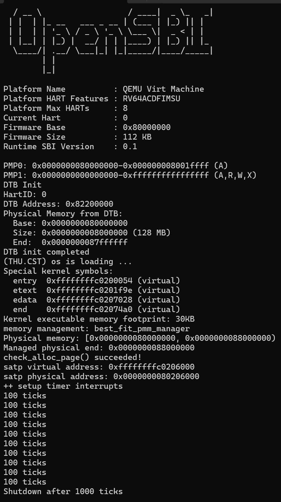
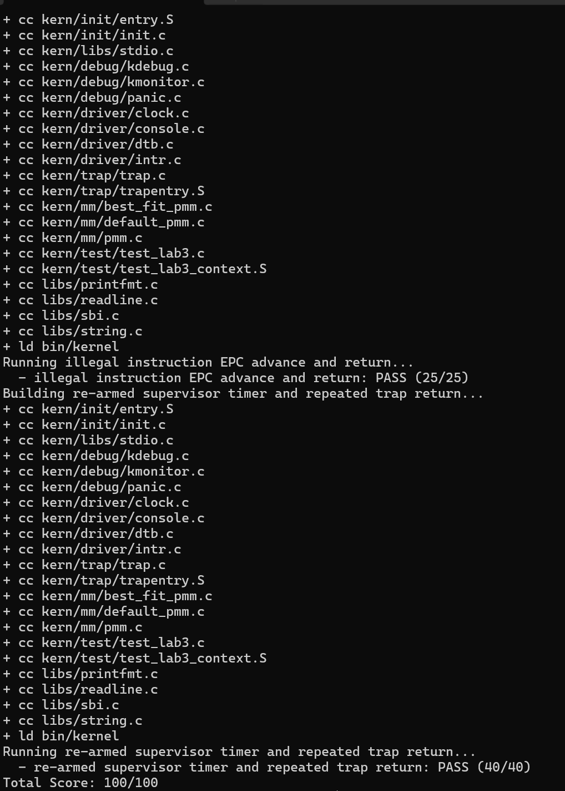

# 操作系统实验报告

## 实验基本信息

| 项目 | 内容 |
| --- | --- |
| **实验名称** | Lab 3：中断与异常处理 |
| **小组成员** | 【2411938-唐源】、【2413905-马诗渊】、【2413140-颜国庄】 |
| **完成日期** | 2026-11-06 |

### 小组分工

| 成员 | 负责的练习/模块 |
| --- | --- |
| 【2411938-唐源】 | 功能模块一：Trap 入口、上下文恢复与汇编到 C 的调用衔接；分析寄存器恢复顺序及入口测试 |
| 【2413905-马诗渊】 | 功能模块二中的中断处理：中断分类、时钟重设、计数输出与关机；分析持续时钟测试 |
| 【2413140-颜国庄】 | 功能模块二中的异常处理：非法指令、断点、指令长度与返回位置更新；分析异常返回及兜底测试 |

**报告分工：** 唐源负责实验环境、整体执行流和功能模块一；马诗渊负责中断处理、时钟机制和运行结果；颜国庄负责异常处理、知识点对应及报告整合。三人分别整理各自模块的规格、提示词和验证说明，实验目的及总结共同讨论。

---

## 一、实验目的

1. 理解 RISC-V 中断和异常的区别，以及二者作为 Trap 的统一处理机制。
2. 理解 `stvec`、`sepc`、`scause`、`stval` 和 `sstatus` 在 Trap 进入、处理与返回过程中的作用。
3. 根据已有的 `SAVE_ALL` 实现上下文恢复，使汇编保存布局与 C 语言的 `struct trapframe` 保持一致。
4. 按 RISC-V 调用约定将现场传给 C 处理函数，建立完整的 Trap 处理闭环。
5. 实现时钟中断的持续触发、软件计数、周期输出与达到条件后的系统关机。
6. 正确处理断点和非法指令异常，根据指令长度更新返回地址，避免重复触发同一异常。
7. 结合规格说明、AI 辅助实现和测试结果检查代码，理解局部中断保护与临界区之间的关系。

---

## 二、实验环境

**AI 编程工具：**

| 成员 | AI 编程工具 | 底层模型 |
| --- | --- | --- |
| 【2411938-唐源】 | Claude Code（终端 Agent） | deepseek-v4-pro |
| 【2413905-马诗渊】 | Claude Code | DeepSeek |
| 【2413140-颜国庄】 | Codex | GPT |

---

## 三、实验整体逻辑分析

### 3.1 本章节的逻辑主线

Lab2 建立了物理内存管理和启动页表，内核已经能够使用基本内存资源。Lab3 在此基础上解决“遇到中断或异常以后，怎样处理并正确回来”的问题。

本章按照“准备入口 → 保存现场 → 调用 C 函数 → 分类处理 → 恢复现场 → Trap 返回”的顺序建立机制。中断可以在原执行流没有主动调用处理函数的情况下发生，因此必须保护原有寄存器状态；异常则与当前指令有关，除了识别原因，还要决定返回后重新执行还是跳过相应指令。

本次基本运行场景是 S 模式内核被中断，处理完后返回 S 模式。发生 Trap 不一定提升特权级，也不一定发生进程切换；本实验尚未实现进程调度。

### 3.2 功能的逐步实现

1. **补齐 Lab2 依赖。** 在 Lab3 框架中迁入物理内存初始化和 Best-Fit 实现，保留 Lab3 对内存操作增加的中断保护。
2. **准备 Trap 入口。** `idt_init()` 将 `__alltraps` 地址写入 `stvec`。虽然函数沿用 IDT 命名，这里实际配置的是 RISC-V 的 Trap 入口。
3. **保存并传递现场。** 入口执行已有的 `SAVE_ALL`，在当前栈建立 `trapframe`，再将其地址作为参数传入 `trap()`。
4. **分类处理。** `trap_dispatch()` 根据 `cause` 的最高位区分中断和异常，再由两个处理函数判断具体原因。
5. **恢复并返回。** `RESTORE_ALL` 恢复关键 CSR 和通用寄存器，最后恢复原 `sp`，再由 `sret` 返回。
6. **验证完整流程。** 正常运行观察连续计时与关机，评分测试检查寄存器现场、异常返回位置和持续时钟中断。

```text
初始化：
kern_init()
  ├─ dtb_init()、cons_init()
  ├─ idt_init() → stvec = __alltraps
  ├─ pmm_init() → 内存初始化与分配器自检
  ├─ clock_init() → 设置第一次时钟事件
  └─ intr_enable() → 开启 S 模式中断响应

一次 Trap：
硬件记录原因、返回位置及相关状态
  → __alltraps
  → SAVE_ALL
  → trap(tf)
  → trap_dispatch(tf)
      ├─ interrupt_handler(tf)
      └─ exception_handler(tf)
  → __trapret
  → RESTORE_ALL
  → sret
  → 恢复执行
```

### 3.3 硬件与软件的分工

| 部分 | 主要职责 |
| --- | --- |
| CPU 硬件 | 更新 `sepc`、`scause`、`stval` 及相关状态字段，按配置转入处理入口 |
| 汇编入口 | 保存通用寄存器和相关 CSR 值，形成现场并调用 C 函数 |
| C 处理函数 | 识别事件类型、执行处理，必要时修改现场中的返回位置 |
| 汇编恢复与 `sret` | 恢复寄存器和返回状态，回到相应特权级及执行位置 |

硬件不会自动将所有通用寄存器保存到栈中，也不会在本框架中自动完成用户栈到内核栈的切换。不能把进入处理入口等同于完整现场已经保存。

---

## 四、实验内容与实现

### 前置准备：衔接 Lab2 代码

Lab3 中需要补入 `kern/mm/pmm.c` 的 `page_init()` 和 `kern/mm/best_fit_pmm.c` 的管理器实现。本次使用 Best-Fit 作为物理页分配器，启动时执行内存管理自检。

`page_init()` 从设备树获取 RAM 范围，设置虚实地址偏移、页号上界与描述符数组，预留内核及描述符占用空间，再注册剩余完整页。最终代码将管理上界限制为 `KERNTOP - PHYSICAL_MEMORY_OFFSET` 对应的物理边界。

迁移时保留了 Lab3 对 `alloc_pages()`、`free_pages()` 和 `nr_free_pages()` 的 `local_intr_save/restore` 包装，避免复制 Lab2 文件后丢失新增保护。

### 功能模块一：Trap 上下文恢复与 Trap 入口

**负责人：** 【2411938-唐源】

#### 模块功能描述

本模块位于 `kern/trap/trapentry.S`，需要补全：

```asm
.macro RESTORE_ALL
    # 从现场恢复执行状态
.endm

__alltraps:
    # 保存现场并调用 C 处理函数
```

`SAVE_ALL` 已经提供，本次保持其布局不变，实现对应的恢复逻辑，并建立汇编入口与 `void trap(struct trapframe *tf)` 的调用关系。

#### 功能要求与 Spec 设计

| 接口 | 前置条件 | 后置条件及约束 |
| --- | --- | --- |
| `__alltraps` 中的调用部分 | `SAVE_ALL` 已执行，`sp` 指向有效现场，栈满足调用约定 | 将该现场地址传给 `trap()`；正常返回后进入 `__trapret`，现场仍可用于恢复 |
| `RESTORE_ALL` | `sp` 指向处理后的现场，返回地址可能已修改 | 恢复 `sstatus`、`sepc` 和可写通用寄存器；原 `sp` 最后恢复，宏外执行已有的 `sret` |

RV64 下每个槽位为 8 字节，现场共 36 个槽位，即 288 字节：

| 槽位 | 内容 |
| --- | --- |
| 0～31 | `x0`～`x31` 的值；第 2 槽保存被打断前的原 `sp` |
| 32 | `sstatus` |
| 33 | `sepc` |
| 34 | 异常附加信息，即 `stval` 的值 |
| 35 | `scause` |

#### 核心实现与理解

**1. 现场地址作为参数传入 C 函数。**

```asm
mv a0, sp
jal trap
```

`a0` 按 RISC-V 调用约定传递第一个指针参数。`mv` 只复制地址，不复制现场，也不引发跳转。此处 `jal trap` 使用 `ra` 建立普通函数返回关系，原执行流的 `ra` 已由 `SAVE_ALL` 保存。

`trap()` 正常返回后，执行顺序进入 `__trapret`。函数调用使用的返回位置与 `sepc` 不同：前者返回到汇编调用点，后者用于整次 Trap 处理结束后恢复原执行流。

**2. 先恢复返回状态，再恢复借用的寄存器。**

```asm
LOAD s0, 32*REGBYTES(sp)
LOAD s1, 33*REGBYTES(sp)
csrw sstatus, s0
csrw sepc, s1
```

代码借用 `s0`、`s1` 搬运 CSR 值，随后从第 8、9 个槽位恢复它们原来的值。如果先恢复它们再搬运 CSR，就会再次覆盖原值。

**3. 原 `sp` 最后恢复。**

```asm
LOAD x2, 2*REGBYTES(sp)
```

当前 `sp` 是现场基址，恢复其他寄存器时一直需要它。最后一条读取先按当前 `sp` 计算地址，再将保存的原栈指针写入 `x2`，因此不需要额外增加 288 字节。

**4. 使用修改后的现场返回。**

C 处理代码可以修改 `tf->epc`，恢复宏会将修改后的值写入 `sepc`。宏不必将 `cause` 和异常附加信息写回 CSR，也不恢复恒为零的 `x0`。最后的 `sret` 根据恢复的返回状态完成控制转移；它并不固定返回 U 模式。

#### 最终提示词

以下按最终实现整理提示词，采用课程要求的四段式结构，供说明本模块的需求与约束。

```text
[PROMPT]
请补全 kern/trap/trapentry.S 中的 RESTORE_ALL 和 __alltraps。
只修改对应 lab3 待填位置，保留注释，不修改 SAVE_ALL 和其他代码。
能访问工程时直接修改文件，否则给出代码及插入位置，简单解释恢复顺序。

[RELY]
这是 RV64 实验，REGBYTES 为 8，已有 LOAD、STORE 宏。
请核对工程中的 SAVE_ALL 和 struct trapframe：
第 0～31 槽保存 x0～x31，第 2 槽保存被打断前的原 sp；
第 32～35 槽依次保存 sstatus、sepc、异常附加信息和 scause。
SAVE_ALL 执行后，sp 指向现场。已有接口：
void trap(struct trapframe *tf);
RISC-V 用 a0 传递第一个指针参数，__trapret 已有 RESTORE_ALL 和 sret。

[GUARANTEE]
补全 RESTORE_ALL 宏和 __alltraps 中调用 trap() 的部分。
不新增函数，不实现中断和异常处理函数。

[SPECIFICATION]
RESTORE_ALL：
Pre-Condition：sp 指向有效现场，C 处理函数已返回。
Post-Condition：恢复 sstatus、sepc 和可写通用寄存器，原 sp 最后恢复。
Requirements：CSR 使用现场中的最新值；临时寄存器也要恢复；
不必恢复 x0 或写回异常信息与 scause，宏内不重复执行 sret。

__alltraps 的调用部分：
Pre-Condition：SAVE_ALL 已保存现场，栈满足函数调用约定。
Post-Condition：trap() 接收到该现场的地址并执行，正常返回后进入
__trapret，sp 仍指向同一份现场。
Requirements：遵守 RISC-V 调用约定，不破坏保存的上下文。
```

#### 实现与验证说明

代码按已有 `SAVE_ALL` 的布局逐项恢复，完成了保存现场、C 函数处理、恢复现场和返回之间的衔接。评分中的入口、寄存器恢复与断点返回测试通过。本报告不另行统计未经完整记录的生成迭代次数。

### 功能模块二之一：中断分类与时钟中断处理

**负责人：** 【2413905-马诗渊】

#### 模块功能描述

在 `kern/trap/trap.c` 的 Lab3 标记处实现：

```c
void interrupt_handler(struct trapframe *tf);
```

函数根据中断原因分类处理，其中 S 级时钟中断负责重新设定事件、更新计数、周期输出并在达到阈值后关机。函数返回后由统一汇编路径恢复现场。

#### 功能要求与 Spec 设计

**Pre-Condition：** `tf` 指向有效现场，调用来自中断分发路径；处理时钟中断前，时钟模块已初始化。

**Post-Condition：** 完成对应中断处理，正常返回时不改变 `tf->epc`。

| 情况 | 处理行为 |
| --- | --- |
| S 级时钟中断 | 每次重设下一事件并增加一次 `ticks`；每 100 次输出；累计输出达到阈值后关机 |
| 已列出的其他中断 | 根据框架常量输出对应类型提示 |
| 无法识别的中断 | 输出原因编号，并调用 `print_trapframe(tf)` |

**Requirements：** 正确去除原因最高位的中断标记；输出次数在多次调用之间保留；不能将时钟中断误当作异常跳过指令。

#### 核心实现与理解

**1. 提取中断原因编号。**

```c
uintptr_t cause = tf->cause &
    ~((uintptr_t)1 << (sizeof(uintptr_t) * 8 - 1));
```

`scause` 的最高位表示中断，其余位表示编号。去掉标记后，再与 `IRQ_S_TIMER` 等常量比较。代码按框架列出的用户级、S 级、旧 H 级和 M 级软件、时钟及外部中断常量输出提示；这些分支是框架内的编号分类，不代表本实验已实现各模式的完整设备处理。

**2. 重设时钟并计数。**

```c
clock_set_next_event();
ticks++;
```

时钟函数通过 SBI 设置一个绝对到期时刻：

```c
sbi_set_timer(get_cycles() + timebase);
```

虽然读取函数名为 `get_cycles()`，其内部实际使用 `rdtime`，读的是时间计数器。代码中 `timebase = 100000`；按指导书的 10 MHz 时间基准换算，设置间隔约为 10 ms。设置事件后 CPU 继续工作，到期并满足响应条件时再进入中断处理。

每次处理时都将下一次事件设置到未来，使时钟中断能够持续发生，并处理当前已到期的定时状态。`ticks` 则只是软件统计，不负责产生中断。

**3. 周期输出与关机。**

```c
static size_t reports;

if (ticks % TICK_NUM == 0) {
    print_ticks();
    if (++reports >= SHUTDOWN_AFTER) {
        cprintf("Shutdown after %lu ticks\n", (unsigned long)ticks);
        sbi_shutdown();
    }
}
```

本次 `TICK_NUM = 100`，`SHUTDOWN_AFTER = 10`，所以每 100 次中断打印一次，累计 1000 次后关机。`reports` 为静态变量，初值为零，能够跨调用累计。

计时是近似的：下一次事件按处理时读取的当前时间加间隔设置，中断延迟与处理开销会影响真实时间，不能将 100 次中断严格等同于精确的一秒。

**4. 未知中断兜底。**

```c
cprintf("Unknown interrupt: cause %lu\n", (unsigned long)cause);
print_trapframe(tf);
```

输出用于诊断。本实验对其他已知中断仅要求基本分类与提示，没有实现真实外设驱动的完整确认和服务流程。

#### 最终提示词

以下按最终实现整理提示词，采用课程要求的四段式结构，供说明本模块的需求与约束。

```text
[PROMPT]
请在 kern/trap/trap.c 的 lab3 待填位置实现 interrupt_handler()。
保留已有代码和注释，不修改其他函数。能访问工程就直接修改，
否则给出代码和位置，并简单解释。

[RELY]
使用工程已有的 struct trapframe 和中断原因常量。
tf->cause 最高位是中断标记，其余位是编号。
可使用 clock_set_next_event()、ticks、TICK_NUM、print_ticks()、
cprintf()、print_trapframe() 和 libs/sbi.h 中的 sbi_shutdown()。
本次将 SHUTDOWN_AFTER 配置为 10，表示输出 10 次后关机；
框架没有定义时，在本模块待填区域补充定义，并引入所需头文件。

[GUARANTEE]
实现 void interrupt_handler(struct trapframe *tf);
允许增加模块内部的静态计数变量，不新增无关功能。

[SPECIFICATION]
Pre-Condition：tf 是有效中断现场，时钟模块已初始化。
Post-Condition：完成对应处理中断，正常返回到统一恢复流程。
Case 1：S 级时钟中断，每次设置下一事件并将 ticks 加一；
达到 TICK_NUM 的整数倍时调用 print_ticks()，累计输出达到
SHUTDOWN_AFTER 次时输出关机时的 ticks 并调用关机接口。
Case 2：框架列出的其他软件、时钟和外部中断，输出对应类型提示；
S 级软件中断的提示为 Supervisor software interrupt。
Case 3：未知中断，输出 Unknown interrupt: cause 加原因编号，
再调用 print_trapframe(tf)。
Requirements：正确提取中断编号，不修改 epc，计数跨调用保留。
```

#### 实现迭代过程

**遇到的问题：** 指导书要求累计输出达到 `SHUTDOWN_AFTER` 后关机，但原始框架中没有该宏的定义，也没有在所给要求中明确数值。处理函数因此缺少可直接使用的关机阈值。

**解决策略：** 保留“按输出次数判断关机”的要求，在 Lab3 实现区域显式增加：

```c
#define SHUTDOWN_AFTER 10
```

同时使用静态变量单独累计输出次数，避免将输出次数与中断次数混淆。10 是本次采用的实现配置，不表述为指导书明确规定的数值。

**最终结果：** 正常运行打印 10 行 `100 ticks`，随后输出 `Shutdown after 1000 ticks` 并退出 QEMU；持续时钟中断评分测试通过。

### 功能模块二之二：非法指令与断点异常处理

**负责人：** 【2413140-颜国庄】

#### 模块功能描述

在 `kern/trap/trap.c` 的 Lab3 标记处实现：

```c
void exception_handler(struct trapframe *tf);
```

函数处理非法指令和断点异常，输出信息并修改返回位置；其他异常打印现场。两个完整处理函数的定义均放在 `trap_dispatch()` 前，使编译器在调用处已经知道函数接口。

#### 功能要求与 Spec 设计

**Pre-Condition：** `tf` 指向有效的异常现场；对需要跳过的指令，`tf->epc` 对应可读取的实验指令地址。

**Post-Condition：** 指定异常输出原因及地址，按对应指令长度更新 `epc`；其他异常只打印现场，不自行修改返回地址。

| 情况 | 处理行为 |
| --- | --- |
| `CAUSE_ILLEGAL_INSTRUCTION` | 输出 `Illegal instruction at` 及异常指令地址，再按长度跳过 |
| `CAUSE_BREAKPOINT` | 输出 `Breakpoint at` 及断点地址，再按长度跳过 |
| 其他异常 | 调用 `print_trapframe(tf)` 后返回 |

**Requirements：** 区分本实验测试中的 16 位与 32 位指令；不能对所有异常统一增加固定偏移；保持通用寄存器现场不变。

#### 核心实现与理解

**1. 判断原因并输出地址。**

```c
case CAUSE_ILLEGAL_INSTRUCTION:
    cprintf("Illegal instruction at 0x%016lx\n",
            (unsigned long)tf->epc);
    break;
case CAUSE_BREAKPOINT:
    cprintf("Breakpoint at 0x%016lx\n",
            (unsigned long)tf->epc);
    break;
```

`epc` 记录触发异常的位置。如果没有修改返回位置，恢复之后会重新执行同一条异常指令，可能反复进入处理程序。这里按实验要求跳过指定指令，不代表通用操作系统会跳过所有非法指令或缺页异常。

**2. 读取指令开头，决定返回偏移。**

```c
uint16_t instruction = *(volatile uint16_t *)tf->epc;
tf->epc += ((instruction & 3) == 3) ? 4 : 2;
```

代码读取起始的 16 位，不直接对可能只满足两字节对齐的地址执行 32 位读取。对于本实验 RV64GC 中的 16/32 位指令，最低两位不为 `11` 时按 2 字节处理，为 `11` 时按 4 字节处理。

这不是适用于所有潜在 RISC-V 指令长度的通用解码器。实现范围是本实验的 16/32 位异常指令，也没有实现任意用户指令地址的安全探测。

修改的是内存中的现场。`RESTORE_ALL` 随后把新 `epc` 写入硬件 `sepc`，最后由 `sret` 转到更新后的位置。

**3. 未指定异常只输出现场。**

```c
default:
    print_trapframe(tf);
    return;
```

直接返回避免未知异常继续执行后面的指令读取与地址调整。打印现场只提供诊断信息，并不意味着故障已经修复；如果原异常条件仍存在，返回后仍可能再次触发。

#### 最终提示词

以下按最终实现整理提示词，采用课程要求的四段式结构，供说明本模块的需求与约束。

```text
[PROMPT]
请在 kern/trap/trap.c 的 lab3 待填位置实现 exception_handler()。
保留已有代码和注释，不修改其他函数。能访问工程就直接修改，
否则给出代码和位置，并简单解释返回地址的处理。

[RELY]
使用 struct trapframe、CAUSE_ILLEGAL_INSTRUCTION、
CAUSE_BREAKPOINT、cprintf() 和 print_trapframe()。
tf->cause 是异常原因，tf->epc 是异常指令地址。
实验使用 RV64GC，需要处理测试中的 16 位和 32 位指令；
起始 16 位的最低两位不为 11 时长度为 2 字节，
本实验的 32 位指令最低两位为 11。指定测试指令地址可读取。

[GUARANTEE]
实现 void exception_handler(struct trapframe *tf);
不新增辅助函数，不实现其他练习。

[SPECIFICATION]
Pre-Condition：tf 指向有效异常现场。
Post-Condition：指定异常输出信息并更新 epc；其他异常打印现场。
Case 1：非法指令，输出 Illegal instruction at 0x 后接
16 位十六进制地址，再按该指令长度更新 epc。
Case 2：断点，输出 Breakpoint at 0x 后接 16 位十六进制地址，
再按该指令长度更新 epc。
Case 3：其他异常，调用 print_trapframe(tf) 后直接返回，epc 不变。
Requirements：只读取指令开头的 16 位来判断测试指令长度，
不能统一加 4；保留其他现场字段，处理后交给已有恢复流程返回。
```

#### 实现与验证说明

非法指令和断点异常共用指令长度判断逻辑，指定异常处理完成后使用统一的现场恢复路径。评分测试检查了断点返回、32 位非法指令返回，以及软件中断、未知中断和其他异常的输出分支。本报告不另列未记录的生成迭代或报错。

### 原理分析：中断关闭与临界区保护

分配和回收物理页时，会修改空闲链表及计数。如果同一执行单元的中断处理路径也使用相关资源，就可能在更新尚未完成时再次访问数据。因此框架采用以下方式保护局部操作：

```c
bool intr_flag;
local_intr_save(intr_flag);
/* 修改内存管理数据结构 */
local_intr_restore(intr_flag);
```

关键是保存并恢复进入前的中断状态。如果外层已经关闭中断，内层退出时不能无条件重新开启。框架的 `__intr_save()` 在原 `SIE` 为 1 时关闭中断并返回真，原本关闭则返回假；`__intr_restore()` 仅在保存值为真时重新开启。

宏采用 `do { ... } while (0)`，使多条语句在语法上表现为一条语句，便于安全放入 `if/else` 等结构中。

关闭本地 S 级中断只能防止相应中断处理路径在本执行单元上插入，不能阻止其他 hart 并发访问，也不能屏蔽指令自身产生的异常。`volatile` 同样不提供互斥或原子递增保证，多核系统仍需要锁或原子指令等同步机制。

---

## 五、测试与验证

### 5.1 正常构建与运行

```bash
cd /home/yangu/os/lab3-run-J71PeM/lab3_new
make clean
make
make qemu
```

本次实际运行输出节选：

```text
OpenSBI v0.4 (Jul  2 2019 11:53:53)
Runtime SBI Version    : 0.1
DTB Address: 0x82200000
Physical Memory from DTB:
  Base: 0x0000000080000000
  Size: 0x0000000008000000 (128 MB)
  End:  0x0000000087ffffff
...
memory management: best_fit_pmm_manager
Physical memory: [0x0000000080000000, 0x0000000088000000)
Managed physical end: 0x0000000088000000
check_alloc_page() succeeded!
satp virtual address: 0xffffffffc0206000
satp physical address: 0x0000000080206000
++ setup timer interrupts
100 ticks
100 ticks
100 ticks
100 ticks
100 ticks
100 ticks
100 ticks
100 ticks
100 ticks
100 ticks
Shutdown after 1000 ticks
```

**正常运行截图：**



图 1：内存分配自检成功，输出 10 次 `100 ticks`，累计 1000 次时钟中断后关机。

**结果分析：** 内存分配自检通过，重复的计时输出说明时钟事件能够持续设置和处理，处理结束后能够返回执行。累计达到 1000 次中断后关机并回到 WSL 终端，与本次阈值配置一致。

正常启动流程没有主动执行断点和非法指令，不能仅凭这部分输出判断异常处理已经验证，需要结合评分测试。

### 5.2 评分测试

```bash
make grade
```

评分目标先创建工程临时副本，通过 `tools/inject.py` 注入测试，然后分别构建运行三组测试。测试源码和通过判据与原始框架保持一致；包内 `grade.sh` 的镜像加载参数由 `-device loader,...` 调整为 `-kernel bin/ucore.img`。

| 测试项目 | 主要检查内容 | 分值 | 结果 |
| --- | --- | --- | --- |
| Trap 入口、寄存器恢复与断点返回 | 汇编入口、现场传递、上下文恢复及断点后的继续执行 | 35 | 通过 |
| 非法指令返回及兜底分支 | 非法指令后继续执行；软件中断、未知中断与其他异常输出 | 25 | 通过 |
| 持续 S 级时钟中断 | 多次重设时钟事件、输出 `100 ticks`，并在测试代码中累计到 `ticks=200` | 40 | 通过 |
| **合计** | | **100** | **100/100** |

本次已运行并确认评分通过，下方截图保留了部分构建过程、后两项测试结果及总分。

**评分结果截图：**



图 2：评分终端输出节选，显示非法指令返回和持续时钟中断测试通过，最终总分为 `100/100`。

### 5.3 验证范围

正常运行验证了连续计数及最终关机；评分测试进一步覆盖入口、寄存器恢复、异常返回和指定兜底输出。它们共同支持本实验要求的处理闭环，但不等于已实现用户进程切换、真实外设驱动或任意异常恢复。

---

## 六、实验总结与收获

### 对操作系统的理解

**1. 本实验重要知识点与 OS 原理的对应关系。**

| 本实验知识点 | 对应 OS 原理 | 含义、关系与差异 |
| --- | --- | --- |
| 中断与异常分类 | 异步事件和同步异常 | 中断与当前指令无直接因果关系，异常由当前指令触发；二者在 RISC-V 中统称 Trap |
| `stvec` 与统一入口 | 中断入口组织 | Direct 模式先统一进入汇编，再由软件按原因分发，并非每类事件各有一个 C 硬件入口 |
| `sepc`、`scause`、`stval` | 故障现场与恢复位置 | 分别记录恢复位置、事件原因和附加信息，为软件处理提供依据 |
| `trapframe` | 上下文保存与恢复 | 在内存中组织寄存器现场，汇编偏移与 C 字段必须一致；保存现场不等于切换进程 |
| `a0` 传参和普通调用 | ABI 与跨语言协作 | 汇编按调用约定传入现场地址，C 函数可以读取及修改同一份现场 |
| `sstatus` 与 `sret` | 特权状态和中断返回 | `SPP` 决定返回特权级，`SPIE/SIE` 配合恢复中断状态；Trap 可以在 S 模式内完成 |
| 时钟重设与 `ticks` | 定时、调度和超时基础 | 定时机制提供周期进入内核的机会；本实验只计数、输出和关机，未实现调度 |
| 异常指令长度与 `epc` 更新 | 异常恢复策略 | 本实验指定异常采用跳过；其他异常可能需要修复后重试或终止执行 |
| 局部中断保存与恢复 | 临界区及并发控制 | 避免本地中断路径插入关键更新，恢复时保持原状态；多核访问仍需额外同步 |
| 框架测试与串口输出 | 系统软件验证 | 正常运行和测试注入验证不同路径，输出正常不能代替所有行为验证 |

**2. OS 原理中重要、但本实验尚未完整对应的知识点。**

1. **用户进程管理与调度。** 尚未建立进程状态、时间片和调度队列，时钟中断后没有切换到其他进程。
2. **完整用户态 Trap 入口。** 未实现用户栈与内核栈切换、完整用户上下文管理和用户地址空间切换。
3. **系统调用服务。** 未实现系统调用号分发、参数合法性检查和用户内存安全访问。
4. **缺页恢复与虚拟内存。** 未实现按需分页、页面置换、写时复制及可恢复的缺页处理。
5. **多核同步。** 局部关中断不足以解决跨 hart 并发，尚未建立锁、内存序和跨核协调机制。
6. **真实设备中断处理。** 其他中断主要输出类型，没有完整实现中断控制器确认、设备服务与完成通知。
7. **通用异常策略。** 未提供任意非法指令模拟、安全取指和面向进程的故障终止机制。

### AI 协作开发的经验

1. **先说明接口，再要求实现。** `SAVE_ALL`、`trapframe` 布局和调用约定决定生成代码能否与框架衔接。只要求“恢复寄存器”不够，还应明确原 `sp` 的保存方式和恢复顺序。
2. **用前置、后置条件检查完整流程。** 入口调用的后置状态必须满足恢复代码的前置条件；异常处理修改的 `epc` 需要由后续代码真正写回 `sepc`。
3. **规格应区分不同情况。** 时钟中断需要重设事件，指定异常需要判断指令长度，其他异常只输出现场，不能用同一种返回策略处理所有原因。
4. **缺失配置要明确说明。** `SHUTDOWN_AFTER` 的名称出现在要求中，但框架未给定义。本次显式设置为 10，并在报告中注明它是实现配置，避免将自行选择的数值当成课程规定。
5. **生成代码后仍要核对和运行。** 本次结合源码检查、正常启动和评分测试验证结果。报告中的整理版提示词与最终代码对应，运行截图用于记录已执行的验证结果。
